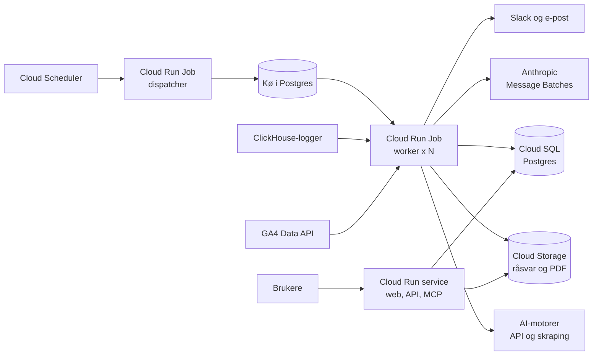

# Ekko – teknisk spesifikasjon

**Produkt:** Ekko – overvåking av merkevarer, nøkkelord og kilder i AI-søk
**Eier:** Nils-Fredrik
**Dato:** 13. november 2026
**Utviklingsstyring:** board.maksimer.es
**Repo:** https://github.com/Nils-Fredrik/ekko
**Referanserepo (kun lesing):** https://github.com/Nils-Fredrik/varde
**Google Cloud-prosjekt:** `ekko-514612`
**Referanseapplikasjoner for stil og teknologi:** varde.maksimer.com og borg.maksimer.es

---

## 1. Formål og omfang

Ekko måler hvordan AI-motorer (ChatGPT, Gemini, Google AI Overviews, Perplexity og Claude) omtaler en merkevare. Verktøyet kjører et fast sett med spørsmål (prompts) mot motorene og registrerer for hvert svar:

- om merkevaren nevnes
- hvor i svaret den nevnes
- om den anbefales
- hvordan den omtales
- hvilke konkurrenter som nevnes
- hvilke kilder (URL-er) motoren bygger på

Resultatene kobles med serverlogger (AI-roboter som henter sidene) og trafikkdata (besøk fra AI-tjenester). Til sammen viser dette hele kjeden fra «AI leser innholdet» via «AI siterer innholdet» til «AI sender trafikk».

Løsningen er en flerkunde-plattform (multi-tenant). Hvert selskap, både i konsernet og blant eksterne kunder, er en egen tenant med egne data, brukere, kvoter og fakturagrunnlag.

**I omfang:**
- tenant-administrasjon
- prompt-bibliotek per marked
- ved oppstart: direkte API-innsamling fra OpenAI, Anthropic og Gemini; DataForSEO og Perplexity er utsatt (7.4)
- automatisk uttrekk av nevnelser og kilder
- metrikker og dashboard
- konkurrentsammenligning
- varsler
- PDF- og e-postrapporter
- oppstartsveiviser
- kvoter og forbruksmåling
- REST-API og MCP-server
- integrasjon mot ClickHouse-logger og GA4

**Utenfor omfang:**
- automatisk endring av kundenes nettsider
- innholdsproduksjon
- selvbetjent registrering og kortbetaling (tenants opprettes av plattformadmin)

---

## 2. Begreper

| Begrep | Betydning |
|---|---|
| Tenant | Lukket kundeenhet med egne data. Teknisk implementert som Jetstream-team. |
| Partner-tenant | Tenant som forvalter andre tenants, f.eks. et byrå med egne kunder. |
| Merkevare (brand) | Det som overvåkes. Har navnevarianter, domener og konkurrenter. |
| Marked | Land + språk, f.eks. `NO/nb` eller `SE/sv`. En merkevare kan ha flere. |
| Prompt | Et spørsmål på markedets språk, merket med tema og intensjon. |
| Motor | En AI-tjeneste med én bestemt innhentingsmetode, f.eks. `chatgpt_api` eller `chatgpt_ui`. |
| Kjøring (run) | Én innhenting av ett svar: prompt × motor × gjentakelse. |
| Nevnelse (mention) | En merkevare (egen eller konkurrent) som forekommer i et svar. |
| Sitat (citation) | En URL motoren oppgir som kilde i et svar. |

---

## 3. Overordnet arkitektur



### 3.1 Google Cloud-komponenter (prosjekt `ekko-514612`, region `europe-west1`)

Ekko har ett miljø, produksjon, i prosjektet `ekko-514612`. Utvikling skjer lokalt mot fixtures, og nye versjoner verifiseres i produksjon før de får trafikk (17.2).

**Adresse:** `https://ekko.maksimer.com` er kanonisk produksjonsadresse og `APP_URL`. Terraform forvalter en global ekstern Application Load Balancer, statisk IPv4, HTTP→HTTPS-omdirigering og Google-administrert sertifikat med DNS-autorisasjon og TLS ≥1.2. DNS publiseres hos eksisterende leverandør; navneservere flyttes ikke. Google OAuth bruker `https://ekko.maksimer.com/auth/google/callback`. Cloud Run-adressene beholdes for kandidat-røyktest og Scheduler. Se ADR 0024 og `infra/terraform/README.md`.


| Komponent | Tjeneste | Konfigurasjon |
|---|---|---|
| Web, API og MCP | Cloud Run service `ekko-web` | min 0, maks 4 instanser, 1 vCPU / 1 GiB, Cloud SQL-tilkobling via Unix-socket |
| Dispatcher | Cloud Run Job `ekko-dispatch` | `php artisan ekko:dispatch-due` |
| Oppvekking fra web | Cloud Run Job `ekko-wake` | Fast `php artisan ekko:dispatch-due --poll`, dispatch-identitet. Web får kun starte uten overrides. |
| Arbeidere | Cloud Run Job `ekko-worker` | Startes kun når køen har arbeid: av dispatcher-identiteten. `extraction-poll` og veiviseren starter den faste `ekko-wake`-jobben, som poller og vekker workeren uten ny dagsplanlegging (ADR 0018 og 0030). Hver task kjører 8 parallelle `queue:work --stop-when-empty --max-time=3300 --timeout=420`-prosesser. Ved oppstart settes `taskCount` til `ceil(jobber i kø / 2000)`, maks 8, med automatisk parallellisme i Cloud Run. Databasekøen reserverer jobber i 450 sekunder. |
| Planlagte oppgaver | Cloud Run Job `ekko-task` | samme image, kommando settes per Scheduler-trigger. Kjører timevis aggregering og forbruksoppdatering samt øvrige planlagte oppgaver (se 7.1). |
| Lette periodiske oppgaver | Interne endepunkter på `ekko-web` | Cloud Scheduler kaller `POST /internal/tick/{oppgave}` med OIDC-token fra en egen tjenestekonto. Endepunktene gjør kun korte kontroller og legger tyngre arbeid i køen. |
| Migrering | Cloud Run Job `ekko-migrate` | `php artisan migrate --force`, kjøres i deploy-pipeline |
| Database | Cloud SQL for PostgreSQL 16, `db-g1-small` | 20 GB SSD, automatisk backup 7 dager, PITR på, påkrevd Cloud SQL-connector og kryptert transport |
| Fillagring | Cloud Storage `ekko-raw` | livssyklus: Nearline etter 90 dager, sletting etter 400 dager |
| Fillagring | Cloud Storage `ekko-reports` | genererte PDF-rapporter |
| Hemmeligheter | Secret Manager | API-nøkler, `APP_KEY`, OAuth-klienter |
| Tidsstyring | Cloud Scheduler | se 7.1 |
| Bilder | Artifact Registry | ett image for web og jobber |
| Overvåking | Cloud Logging, Error Reporting, Monitoring | varsler i 17.4 |

Det brukes ingen Redis eller Memorystore. Kø, cache, låser og rate limiting går via Postgres med Laravels `database`-drivere, noe som holder kostnaden nede.

---

## 4. Teknologistakk

Stakken følger Varde. Agentene har lesetilgang til Varde-repoet (https://github.com/Nils-Fredrik/varde) og skal bruke det som mal for mappestruktur, versjoner, Dockerfile, layout-komponenter, i18n-oppsett og MCP-oppsett, heller enn å finne opp egne (4.1).

| Lag | Valg |
|---|---|
| Rammeverk | Laravel (samme hovedversjon som Varde) |
| Startpakke | Laravel Jetstream med Inertia-stakken (team aktivert, API-tokens aktivert) |
| Frontend | Vue 3 via Inertia, Vite, Tailwind CSS v4 |
| Ruting i frontend | Ziggy |
| Ikoner | Heroicons for Vue |
| Oversettelser | `laravel-vue-i18n` med PHP-språkfiler (`nb`, `sv`, `en`) |
| Grafer | Apache ECharts fra `echarts/core` med SVG-tegning, lastet asynkront og fargesatt fra designtokens, gjennom `<EkkoChart>` ([ADR 0035](decisions/0035-echarts-grafbibliotek.md), `docs/ui-forbedring.md` kapittel 5–6). Chart.js står igjen til U05–U10 har erstattet de gamle grafene |
| Database | PostgreSQL 16 |
| Kø og cache | Laravel `database`-driver |
| MCP | `laravel/mcp` med egen OAuth 2.1-server og Sanctum-nøkler, samme mønster som Varde (`Pages/Mcp/Authorize.vue`, `Pages/Mcp/Connections.vue`). Passport kan ikke brukes sammen med Sanctum på samme `User` ([ADR 0016](decisions/0016-mcp-server-og-oauth.md)) |
| Innlogging | Jetstream (e-post og passord, 2FA) og Socialite (Google) |
| PDF | `spatie/laravel-pdf` med Chromium i worker-imaget |
| Revisjonslogg | `spatie/laravel-activitylog` |
| Funksjonsflagg | Laravel Pennant, med flagg per tenant |
| Filer | Flysystem-adapter for Google Cloud Storage |
| HTTP mot motorer | Laravels `Http`-klient med egne adapterklasser (ingen tredjeparts LLM-rammeverk, fordi adapterne må bruke leverandørspesifikke funksjoner som kildeannotasjoner og lokasjon) |
| Testing | Pest, inkludert nettlesertester |
| Kodekvalitet | Laravel Pint, Larastan nivå 6, ESLint og Prettier for Vue |
| Infrastruktur | Terraform |
| CI/CD | GitHub Actions med Workload Identity Federation mot GCP |

### 4.1 Hva agentene henter fra Varde

Varde-repoet er kun referanse. Agentene leser og kopierer mønstre derfra inn i Ekko, men gjør aldri endringer, commits, grener eller PR-er i Varde. `main` i Varde har grenbeskyttelse som krever godkjent PR, slik at en agent ikke kan skrive dit ved en feil.

| Hva | Hvorfor |
|---|---|
| `composer.json`, `composer.lock`, `package.json`, `package-lock.json` | Samme versjoner av Laravel, Jetstream, Inertia, Vue, Tailwind og øvrige pakker |
| Tailwind-temafilen (`@theme` med fargetokens og mørkt/lyst tema) og fontfilene for Suisse Intl | Identisk look & feel (14.1) |
| Layout og fellesskomponenter: `AppLayout`, toppmeny, team-velger, temabytte, språkvelger, `BottomSheet`, `DialogModal` | Samme oppbygging og oppførsel |
| `Pages/Auth/Login.vue` | Samme innloggingsside |
| Oppsett av Inertia, Ziggy og `laravel-vue-i18n` (app-inngangen og en språkfil) | Samme oppsett for ruting og oversettelser |
| `Pages/Mcp/Authorize.vue`, `Pages/Mcp/Connections.vue`, MCP-serverklassen, ett eksempel på et MCP-tool og OAuth-kontrolleren | Samme MCP- og OAuth-mønster (15.2) |
| `Dockerfile` og eventuelle Cloud Run- og GitHub Actions-filer | Samme byggeløp og kjøremiljø på Cloud Run (T10) |

Ingen miljøfiler, hemmeligheter eller kundedata kopieres fra Varde.

---

## 5. Tenant-modell og tilgang

### 5.1 Struktur

- **Tenant = Jetstream-team.** Tabellen `teams` utvides med kolonnene i 6.1.
- **Partner-forhold:** `teams.partner_team_id` peker til forvaltende tenant. Det er maks ett nivå: en partner kan ikke selv ha en partner.
- **Plattformadmin:** `users.is_platform_admin`. Gir tilgang til alle tenants og til admin-sidene.

### 5.2 Roller

| Rolle | Omfang | Rettigheter |
|---|---|---|
| Plattformadmin | Alle tenants | Opprette, endre og stenge tenants. Sette pakke, kvoter og motorer. Se forbruk og kostnad. Opptre som tenant (logges). |
| Partner-rådgiver | Egen tenant og alle kunde-tenants med `partner_team_id` = egen tenant | Som tenant-admin i kunde-tenantene, men kan ikke slette dem eller endre pakke |
| Tenant-admin | Egen tenant | Invitere og fjerne brukere, redigere merkevarer, markeder, prompts og konkurrenter, sette varsler og rapportmottakere, se forbruk |
| Redaktør | Egen tenant | Redigere prompts og konkurrenter, kjøre manuelle kontroller innenfor kvote |
| Leser | Egen tenant | Se dashboard, svar, kilder og rapporter |

Rollene implementeres med Jetstream-roller per team, med Laravel Policies som eneste tilgangsmekanisme i kode. Partner-tilgang løses i en sentral `TenantAccess`-tjeneste som policyene bruker.

### 5.3 Tenant-isolasjon, to lag

**Lag 1, applikasjonen:** Alle tenant-eide modeller bruker trait `BelongsToTenant`. Traiten:
- legger på et globalt scope `tenant_id = current_tenant_id()`
- setter `tenant_id` automatisk ved opprettelse
- kaster unntak hvis ingen tenant er satt i konteksten (gjelder også jobber)

Jobber får alltid `tenant_id` som konstruktørparameter og setter konteksten via middleware `SetTenantContext`. Den synkrone motorinnsamleren bruker én RLS-transaksjon for reservasjon og én for oppgjør, med leverandørkallet mellom dem (ADR 0013).

**Lag 2, databasen:** Postgres Row-Level Security på alle tenant-eide tabeller.

```sql
ALTER TABLE brands ENABLE ROW LEVEL SECURITY;
ALTER TABLE brands FORCE ROW LEVEL SECURITY;
CREATE POLICY tenant_isolation ON brands
  USING (tenant_id = ANY (string_to_array(current_setting('app.tenant_ids', true), ',')::bigint[]));
```

Applikasjonen kobler til med en rolle uten `BYPASSRLS`. Ved hver forespørsel og hver jobb settes `app.tenant_ids` til tenantene brukeren eller jobben har lov til å se. For en partner er det egen tenant pluss kunde-tenantene. `ApplyTenantRls` setter tilgangen med `SET LOCAL` i en databasetransaksjon. Motorinnsamleren bruker den samme transaksjonshjelperen i hver databasefase.

Migreringer bruker en egen databaserolle med `BYPASSRLS`, kun tilgjengelig for jobben `ekko-migrate`. Web-tjenesten bruker den vanlige RLS-rollen også for dagens plattformadmin-handlinger og får verken migreringspassordet, Secret Manager-lesetilgang til det eller `DB_ADMIN_*`-variabler. Hvis en senere admin-handling krever `BYPASSRLS`, må den få en separat rolle uten tabelleierskap eller DDL-rettigheter i en eksplisitt, logget kjørevei; migreringslegitimasjonen skal ikke tilbake til web (T39-F1).

Innloggingsrollen sjekkes ved oppstart i produksjon (T39-F2, `App\Tenancy\Rls\DatabaseRoleCheck`). Kode utenfor `TenantRls::run()` kjører som innloggingsrollen, så en feil `DB_USERNAME` ville ellers latt RLS stoppe ingenting uten at noen merket det. Rollen er usikker hvis minst ett av disse gjelder:
- Den er superbruker eller har `BYPASSRLS`, `CREATEROLE` eller `CREATEDB`.
- Den er medlem av en rolle som er superbruker, har `BYPASSRLS` eller er `cloudsqlsuperuser`. Et medlem kan bytte til rollen med `SET ROLE` (ADR 0007).
- Den eier, eller er medlem av eieren av, en tabell med `tenant_id` eller `team_id`.

En usikker rolle gir dette:
- `/up` feiler. Det er oppstartsproben til `ekko-web`, så revisjonen får aldri trafikk.
- Køarbeideren (`queue:work`) og alle `ekko:*`-kommandoer stopper før de starter.

Migreringene sjekkes ikke, fordi de skal kjøre som eieren av tabellene. Sjekken styres med `DB_VERIFY_LOGIN_ROLE` og er på når `APP_ENV=production`. Rollen sjekkes bare når en instans eller kommando starter. `ekko-web` har ingen liveness-probe mot `/up`, så endres rollen mens en revisjon kjører, merkes det først ved neste revisjon.

Tilkoblingen `pgsql_admin` har bare én inngang, `App\Tenancy\AdminConnection`. Bare den innloggede brukeren kan bruke den, og bare hvis hen er plattformadmin. Brukeren hentes fra økten, aldri fra et argument. Hver bruk og hvert avvist forsøk logges med hvem og hvorfor. En test i `CodebaseGuardsTest` feiler hvis andre filer i `app`, `routes`, `config`, `database`, `bootstrap` eller visningene nevner tilkoblingen.

Tabellene `team_user`, `team_invitations`, `mcp_connections` og `mcp_auth_codes` hører til en tenant gjennom `team_id` og står bevisst utenfor RLS. De leses for å finne ut hvilke tenants noen har tilgang til, før tenantkonteksten er satt, så appen filtrerer dem selv. Begrunnelsen står i `RlsAudit::TEAM_TABLES_OUTSIDE_RLS`. En ny tabell med `team_id` må føres opp der med begrunnelse, eller få `tenant_id` og RLS. Ellers feiler testene.

**Krav:** Testsuiten `tests/Feature/TenantIsolation` skal bevise at:
- ingen rute, ingen API-endepunkt og ingen MCP-tool returnerer data fra en annen tenant
- ingen jobb skriver data til feil tenant

Testene kjøres i CI på hver PR og kan ikke markeres som hoppet over.

### 5.4 Innlogging

- **E-post og passord** via Jetstream. 2FA er påkrevd for plattformadmin og partner-rådgivere og valgfritt for andre.
  - Kravet kan slås av med `EKKO_REQUIRE_TWO_FACTOR=false` (Terraform `require_two_factor`), bare mens eieren tester før lansering (eierens beslutning 2026-11-18, T07-F1). Standard er på, og det slås på igjen før T40. Den som har satt opp 2FA, blir fortsatt spurt ved innlogging.
- **Google** via Socialite. En Google-konto kobles til en eksisterende invitert bruker basert på verifisert e-postadresse. Det finnes ingen åpen registrering. Microsoft er utsatt (eierens beslutning 2026-11-14); hva som kreves når den kommer, står i `docs/decisions/0008-innlogging-og-invitasjoner.md`.
- **Bekreftelse uten passord:** en bruker med koblet Google-konto kan bekrefte med Google i stedet for passord, der appen ellers krever bekreftet passord (slå på 2FA, «opptre som tenant»). Google bes om kontovelger og ny autentisering (`prompt=select_account`, `max_age=0`), men appen kan ikke kontrollere at Google krever det. I praksis bekrefter brukeren at hen har kontroll over den koblede Google-kontoen i nettleseren (ADR 0008). Bare den kontoen som er koblet til den innloggede brukeren, i en bekreftelse som økten selv startet, gir bekreftelse. Callback-adressen er den samme som ved innlogging (T07-F2).
- **Invitasjon:** tenant-admin inviterer på e-post (Jetstream team invitations). Invitasjonen utløper etter 7 dager, kontrollert på serveren. Den kan bare godtas av en innlogget bruker med samme, bekreftede e-postadresse. Å endre e-postadressen krever ny bekreftelse. En Google-konto med en gyldig invitasjon får opprettet brukeren og godtar invitasjonene (ellers ingen bruker). Kontoer kobles til eksisterende brukere bare når leverandøren har verifisert e-posten og brukerens egen adresse er bekreftet. Detaljer i `docs/decisions/0008-innlogging-og-invitasjoner.md`.
- **Tenant-velger:** brukere med flere tenants bytter mellom dem i toppmenyen, som Jetstreams team-switcher. Valgt tenant lagres på brukeren.
- **Sesjon:** samme oppsett som Varde, med `__Host-`-prefiks på sesjonscookien, `secure` og `samesite=lax`.

---

## 6. Datamodell

Alle tenant-eide tabeller har `tenant_id bigint not null` med fremmednøkkel til `teams.id`, indeks og RLS. Tidsstempler lagres i UTC. Relasjoner mellom tenant-eide tabeller med vanlig fremmednøkkel sjekker også at radene tilhører samme tenant (se [ADR 0006](decisions/0006-tenant-eide-tabellrelasjoner.md)).

### 6.1 Tenant og tilgang

| Tabell | Viktige kolonner |
|---|---|
| `teams` (utvidet) | `partner_team_id`, `plan_id`, `status` (active, paused, closed), `default_locale`, `timezone`, `branding` (jsonb: logo-sti, primærfarge; T28 lagrer primærfargen, logo-stien settes i T32), `slack_webhook_url` (kryptert), `byok_enabled`, `monthly_call_quota_override`, `monthly_byok_budget_usd`, `billing_markup_percent` (nullable desimal; ADR 0021) |
| `users` (utvidet) | `is_platform_admin`, `locale`, `current_team_id` |
| `plans` | `name`, `max_brands`, `max_markets_per_brand`, `max_prompts_per_market`, `allowed_engines` (jsonb), `max_frequency`, `engine_max_frequencies` (jsonb), `max_repetitions`, `monthly_call_quota`, `monthly_budget_usd` |
| `tenant_api_keys` | `tenant_id`, `provider`, `key` (kryptert), `last_verified_at` |

### 6.2 Konfigurasjon

| Tabell | Viktige kolonner |
|---|---|
| `brands` | `tenant_id`, `name`, `slug`, `primary_domain`, `status` |
| `brand_aliases` | `brand_id`, `alias`, `match_mode` (exact_word, case_insensitive, regex) |
| `brand_domains` | `brand_id`, `domain`, `include_subdomains` |
| `competitors` | `tenant_id`, `brand_id`, `name`, `is_active` |
| `competitor_aliases` | `competitor_id`, `alias`, `match_mode` |
| `competitor_domains` | `competitor_id`, `domain` |
| `markets` | `tenant_id`, `brand_id`, `country` (ISO 3166-1), `language` (BCP 47), `location_label` (f.eks. «Oslo»), `is_active` |
| `market_engines` | `tenant_id`, `market_id`, `engine_key`, `frequency` (daily, weekly, monthly, off), `prompt_scope` (all, core), `repetitions` (1–3, standard 1) |
| `brand_facts` | `tenant_id`, `brand_id`, `text` (høyst 300 tegn), `is_active` (11.6) |
| `topics` | `tenant_id`, `brand_id`, `name`, `cross_market_key` (kobler samme tema på tvers av markeder) |
| `prompts` | `tenant_id`, `market_id`, `topic_id`, `text`, `intent` (category, comparison, brand, problem, local), `funnel_stage` (awareness, consideration, decision), `priority` (core, standard), `is_active`, `text_hash` |
| `engines` | `key`, `family` (chatgpt, gemini, google_aio, perplexity, claude), `method` (api, ui_scrape, serp), `provider`, `model_id`, `config` (jsonb), `is_enabled` |
| `engine_prices` | `engine_key`, `valid_from`, `price_per_call_usd`, `price_per_1k_input_tokens_usd`, `price_per_1k_output_tokens_usd`, `price_per_search_usd` |

### 6.3 Innsamling og resultater

| Tabell | Viktige kolonner |
|---|---|
| `run_batches` | `tenant_id`, `market_id`, `scheduled_for`, `status`, `planned_runs`, `completed_runs`, `failed_runs` |
| `runs` | `tenant_id`, `run_batch_id`, `prompt_id`, `engine_key`, `repetition`, `status` (queued, running, submitted, collected, extracted, failed, skipped_quota), `attempts`, `error_code`, `started_at`, `finished_at`, midlertidig kvotereservasjon |
| `responses` | `tenant_id`, `run_id`, `engine_key`, `model_id_reported`, `answer_text`, `answer_language`, `raw_uri` (GCS), `input_tokens`, `output_tokens`, `search_calls`, `cost_usd`, `collected_at`, `answer_type` (list, single_recommendation, comparison, informational, refusal), `llm_failed`, `facts_checked_at` (11.6) |
| `mentions` | `tenant_id`, `response_id`, `entity_type` (brand, competitor, unknown), `entity_id` (null for unknown), `surface_name`, `first_char_offset`, `list_position` (null hvis ikke liste), `is_recommended`, `sentiment` (-1.0–1.0), `detection` (deterministic, llm) |
| `citations` | `tenant_id`, `response_id`, `url`, `url_normalized`, `domain`, `ownership` (own, competitor, third_party), `competitor_id`, `source_type` (news, review, forum, wiki, marketplace, social, gov, other), `rank_in_answer`, `from_annotation` (bool) |
| `claims` | `tenant_id`, `response_id`, `brand_id`, `fact_id`, `text`, `quote`, `verdict` (supported, contradicted, unrelated), `source_citation_ids` (jsonb); påstander om merkevaren i et svar, vurdert mot et aktivt faktum (11.6) |
| `extraction_jobs` | `tenant_id`, `provider_batch_id`, `status` (submitted, completed, failed), `response_ids` (jsonb), `submitted_at`, `completed_at` |

### 6.4 Aggregater

| Tabell | Nøkkel | Innhold |
|---|---|---|
| `agg_daily` | `tenant_id`, `brand_id`, `market_id`, `engine_key`, `prompt_id`, `date` | `responses`, `brand_mentioned`, `brand_recommended`, `sum_position`, `count_position`, `list_responses`, `first_place`, `sum_sentiment`, `count_sentiment`, `own_cited`, `competitor_only_responses`, `competitor_mentions` (jsonb per competitor_id) |
| `agg_source_daily` | `tenant_id`, `brand_id`, `market_id`, `engine_key`, `domain`, `date` | `citations`, `responses_with_domain`, `gap_responses` |
| `bot_hits_daily` | `tenant_id`, `brand_id`, `domain`, `bot`, `date` | `hits`, `unique_paths`, `top_paths` (jsonb) |
| `ai_referrals_daily` | `tenant_id`, `brand_id`, `source`, `date` | `sessions`, `engaged_sessions`, `conversions` |

Ukes- og månedstall beregnes fra `agg_daily` i spørringer (`MetricsService`). De lagres ikke separat. `list_responses`, `first_place`, `count_sentiment`, `competitor_only_responses` og `gap_responses` er lagt til for formlene i kapittel 9 (ADR 0012). Dagen er tenantens lokale dag (`teams.timezone`), og bare svar fra kjøringer med status `extracted` teller.

### 6.5 Drift og økonomi

| Tabell | Viktige kolonner |
|---|---|
| `usage_events` | `tenant_id`, `occurred_at`, `kind` (engine_call, extraction, onboarding, pdf, actions, factcheck), `engine_key`, `calls`, `input_tokens`, `output_tokens`, `search_calls`, `cost_usd`, `billed_to` (platform, byok), `run_id` |
| `usage_monthly` | `tenant_id`, `month`, `calls`, `cost_usd`, `quota_calls`, `budget_usd`, `byok_cost_usd`, `byok_budget_usd`, `quota_alerted_threshold`, `status` (ok, warning, capped) |
| `alert_rules` | `tenant_id`, `brand_id`, `type`, `threshold`, `channels` (jsonb), `is_active` |
| `alerts` | `tenant_id`, `alert_rule_id`, `subject`, `triggered_at`, `payload` (jsonb), `digest_date`, `deliveries` (jsonb, kvittering per kanal), `delivered_at`, `acknowledged_by`, `acknowledged_at` |
| `alert_evaluations` | `tenant_id`, `local_date`, `evaluated_at` (én rad per tenant og lokal dag, unik; gjør at evalueringen kjører én gang per døgn) |
| `report_schedules` | `tenant_id`, `brand_id`, `cadence` (weekly, monthly), `recipients` (jsonb), `locale`, `branding` (tenant, partner) |
| `reports` | `tenant_id`, `report_schedule_id`, `period_start`, `period_end`, `pdf_uri`, `sent_at` |
| `integrations` | `tenant_id`, `brand_id`, `type` (clickhouse_logs, ga4), `config` (kryptert jsonb), `last_sync_at`, `last_failed_on`, `status` |
| `activity_log` | fra spatie/laravel-activitylog, med `tenant_id` |
| `model_changes` | `tenant_id`, `engine_key`, `changed_on`, `from_model`, `to_model`, `changed_at` (modellbytte-markører, 7.5) |
| `work_signals` | `tenant_id`, `kind` (extraction, aggregation, usage_rollup), `scope` (bare interne ID-er: `tenant`, `run_batch:<id>`, lokal dato eller UTC-måned), `version`, `processed_version`, `available_at`, `lease_token`, `lease_version`, `lease_expires_at`, `attempts`, `deferred`, `failing_since`, `stopped_at`, `last_error` (unntaksklasse), `pending_since`; unik per tenant, type og omfang (varige behandlingsbehov, 7.1, ADR 0032) |

---

## 7. Innsamling

### 7.1 Planlegging

| Scheduler-trigger | Tidspunkt (Europe/Oslo) | Kommando |
|---|---|---|
| `dispatch-due` | daglig 01:00 | Oppretter `run_batches` og `runs` for alle aktive markeder som er forfalt, og starter `ekko-worker`. Venter inntil 300 sekunder på dispatch-låsen; poll som møter opptatt lås gjør ingen ny planlegging og kontrollerer fortsatt worker-køen (ADR 0030) |
| `extraction-poll` | hvert 15. minutt, via internt endepunkt | Starter fast `ekko-wake` uten overrides. Dispatch-identiteten sender ubehandlede svar i batch, henter ferdige batcher og starter `ekko-worker` hvis køen har arbeid som ikke allerede behandles |
| `aggregate` | hver time | `ekko:aggregate --sync` (i dag og de tre foregående dagene i tenantens tidssone, `ekko.aggregate.lookback_days`), idempotent. Varselsevalueringen (T24) har egen trigger, `alerts` under (ADR 0012, ADR 0019) |
| `alerts` | hver time, kvart over | `ekko:evaluate-alerts --sync`. Hver tenant evalueres én gang per lokal dag, ved første kjøring etter 05:30 i tenantens tidssone, og kjøringen leverer døgnmeldingen. Senere kjøringer samme dag prøver bare feilede kanaler på nytt. Kvotevarselet ved 100 % sendes av første kjøring etter at det oppstår, uansett tid på døgnet (ADR 0019) |
| `log-sync` | daglig 04:00 | `ekko:sync-bot-hits` og `ekko:sync-ga4` |
| `reports` | mandag 06:30 og den 1. hver måned 06:30 | `ekko:send-reports` |
| `usage-rollup` | hver time, via `ekko-task` | `ekko:usage-rollup` og kvotekontroll |
| `work-recover` | hver time, minutt 7, via internt endepunkt | Reservekontrollen for hendelsesstyrt arbeid (T40-F4, ADR 0033). Finnes fra utrullingstrinnet `ready` |

`extraction-poll`, `aggregate` og `usage-rollup` er den gamle behandlingsveien. Fra utrullingstrinnet `ready` (`infra/terraform/work.tf`) styres de av trinnet og ikke av `enable_dashboard_schedules`, og i trinnet `event` er de satt på pause (T40-F4).

**Avgrenset aktivering:** Terraform-bryteren `enable_dashboard_schedules` aktiverer `extraction-poll`, `aggregate` og `usage-rollup` uten å aktivere øvrige schedules. Polling kan gjenoppta allerede kølagt innsamling og sende inn betalte uttrekk, men planlegger ikke nye daglige kjøringer. Begge brytere er av som standard; `enable_schedules` aktiverer alle ordinære schedules. Aktivering krever eierens godkjenning og verifisering etter [runbook](runbook.md#automatisk-behandling-av-innsamlede-svar).

**Fordeling over uka:** Ved ukentlig frekvens kjøres et prompt på ukedagen `crc32(prompt_id) % 7`. Ved månedlig frekvens kjøres det på dag `crc32(prompt_id) % 28 + 1`. Prompts med `priority = core` kan ha høyere frekvens enn resten av markedet, begrenset av pakken. Dette gir jevn belastning og jevn kostnad.

Implementasjonsvalg for idempotens, motorgrenser, forbruksføring og Scheduler-autentisering står i [ADR 0020](decisions/0020-dispatch-og-worker.md). Køoppgaver som fortsatt venter seks timer etter den ene nye innsendingen, avsluttes som feilet. Produksjonsstart verifiseres med T10 etter bootstrap. [ADR 0030](decisions/0030-avgrenset-worker-start.md) avgrenser web til en fast poll-jobb og håndhever connector/TLS for Cloud SQL. Et vellykket `extraction-poll`-kall bekrefter oppstart/allerede aktiv dispatcher; senere jobbfeil varsles av T36.

**Rettferdig kø:** Dispatcheren legger jobbene i køen flettet per tenant (rundgang), slik at én stor tenant ikke blokkerer andre.

**Hendelsesstyrt behandlingsarbeid (T40-F2, [ADR 0032](decisions/0032-varig-hendelsesstyrt-arbeid.md)):** Varige behandlingsbehov registreres i `work_signals` med `App\Work\WorkSignals::signal()`, i samme databasetransaksjon som dataendringen. Det finnes tre typer: uttrekk per tenant eller innhentingsgruppe, aggregering per lokal dato og forbruksoppdatering per UTC-måned.
- Gjentatte signaler for samme omfang samles i én rad og øker `version`. En behandler leaser gjeldende versjon og kvitterer bare for den. Signaler som kommer under kjøringen, blir stående.
- Vekking (`WorkWakeUp`, bare tenant- og signal-ID) publiseres etter commit gjennom `WorkPublisher`. Rollback gir verken behov eller vekking.
- Leases utløper og kan overtas, og et overtatt token kvitterer ingenting. Feil gis eksponentiell backoff. Etter 24 timer med sammenhengende feil (`ekko.work.stop_after_seconds`) stoppes signalet (`stopped_at`) og varsles som `work_stopped` gjennom helsekontrollen; et nytt signal for samme omfang eller `ekko:work:retry <tenant-id> <signal-id>` starter det igjen. Backoff og utsettelser fra handleren (`deferred`, for eksempel en modellbatch som fortsatt kjører) beholder tidspunktet sitt når nye signaler kommer. `ekko:work:recover` publiserer vekking på nytt for forfalte signaler som ikke er vekket, og for signaler med utløpt lease.
- Del 1 kobler ingen produsenter og endrer ingen planer.

**Kjeding (T40-F3, ADR 0032):** Funksjonsbryteren `ekko.work.chaining` (`EKKO_WORK_CHAINING`, av som standard) kobler produsentene til signalene. Når den er på, registrerer ferdig applikasjonsarbeid neste steg i samme transaksjon som lagringen:
- **Innhenting → uttrekk:** `EngineCollector` og `QueuedEngineCollector` signalerer `extraction` for svarets innhentingsgruppe (`run_batch:<id>`) når kjøringen blir `collected`. Gruppen er klar med en gang når ingen kjøring i den lenger er `queued`, `running` eller `submitted`, eller når den har en full batch (`ekko.anthropic.extraction.batch_size`) med svar som ikke allerede ligger i en innsendt batch. Ellers venter den høyst `ekko.work.extraction.group_wait_seconds` (standard 600 s) fra første svar, så én treg motor ikke holder resten tilbake. En kjøring som ender uten svar under innsamling (`failed`, eller `skipped_quota` i innsamlerne), signalerer gruppen hvis den da er ferdig og har svar som venter. Kvotestopp ved planlegging (dispatcher og første kjøring i veiviseren) skjer før gruppen har svar og signalerer ikke. Kjøringenes egne statuser er grunnlaget, ikke tellerne på `run_batches`.
- **Uttrekk:** handleren sender neste batch med samme kode som `SubmitExtractionBatch` (`ExtractionSubmitter`) og signalerer omfanget på nytt når flere svar venter. Statuskontrollen av en innsendt batch er et eget signal (`extraction_job:<id>`). En batch som fortsatt kjører, utsettes med `retryAt` etter batchens alder (dobling) mellom `status_first_seconds` (60 s) og `status_max_seconds` (900 s), pluss jitter. Ingen worker venter, og ingen ny batch sendes for å sjekke status. En ferdig batch legger `PollExtractionBatch` i køen etter commit, og kontrollene stopper. En batch som ikke er ferdig etter 25 timer, gis opp som i `PollExtractionBatch` (8.2).
- **Uttrekk → aggregering:** `ExtractionWriter::markExtracted` (normal batch, tomt svar og terminal fallback) signalerer `aggregation` for den lokale datoen til `responses.collected_at` i tenantens tidssone, også for sene resultater utenfor `ekko:aggregate` sitt tilbakeblikk. Handleren kjører `DailyAggregator` for datoen, så resultatet er det samme som en full omberegning.
- **Forbruk:** hver `UsageEvent` (innhenting, uttrekk, veiviser og rapporter) signalerer `usage_rollup` for sin UTC-måned. Handleren kjører `UsageRollup::refreshMonth` for inneværende eller forrige måned, med samme regler og under samme tenantlås som `ekko:usage-rollup`, så forbruk og terskelvarsler ikke telles to ganger.
- Når bryteren er av, registreres ingenting og flyten er som før (`PollExtractionBatch` poller selv). Planene over (`extraction-poll`, `aggregate`, `usage-rollup`) kjører uendret som reserve også når bryteren er på; alt de gjør, er idempotent mot kjedingen. T40-F4 innfører målrettet vekking med Cloud Tasks, kjører `ekko:work:recover` som reservekontroll og slår av de ordinære planene etter verifisert overgang.

**Målrettet vekking (T40-F4, [ADR 0033](decisions/0033-malrettet-vekking-med-cloud-tasks.md)):** Med `EKKO_WORK_PUBLISHER=cloud_tasks` blir hver vekking en Cloud Tasks-oppgave i køen `ekko-work`. Oppgave-ID-en er deterministisk (hash-prefiks og `WorkWakeUp::key()`), `scheduleTime` er tidligste behandlingstid, og innholdet er bare tenant- og signal-ID. Oppgaven går til den faste ruten `POST /internal/work/wake` med OIDC-token for `ekko-tasks` og audience `{APP_URL}/internal/work`.
- Web leser signalet under tenantens RLS, legger `ProcessWorkSignal` i køen (unik per signalversjon) og sørger for en worker. En aktiv worker foretrekkes; ellers vekkes den faste `ekko-wake` uten overrides (ADR 0030), høyst hvert andre minutt. Web behandler aldri selv og starter aldri workeren.
- Svar: 204 når leveringen ikke har mer å vokte (ferdig, stoppet, ukjent, annen tenant, eller senere tidspunkt med egen vekking), og 425 til en worker har leaset eller kvittert arbeidet. 422 for misdannet innhold, 401 for feil identitet eller audience, og 503 hvis dispatcheren ikke kan vekkes.
- En workerprosess som stopper mens køjobber venter på et senere tidspunkt, publiserer en køvekking til `POST /internal/work/queue-wake` for det tidligste av dem. Dermed gjenopptas forsinket arbeid uten fast poll.
- Reservekontrollen `work-recover` publiserer vekking på nytt for forfalte signaler uten levende lease (aldri publisert, feilet publisering, utløpt lease). Den vekker dispatcheren bare når køjobber står klare uten aktiv worker. Den regner ikke om noe og starter ingenting i en tom time.
- Utrullingen styres av det versjonerte trinnet `legacy` → `ready` → `shadow` → `event` i `infra/terraform/work.tf`. Standard er `legacy`, altså dagens produksjon. En plan som ville flytte trinnet bakover, stoppes; tilbakerulling er en bevisst plan med `allow_work_rollout_downgrade=true`. Produksjonsaksepten følger [docs/t40-f4-produksjonsaksept.md](t40-f4-produksjonsaksept.md).

### 7.2 Kvotekontroll før kjøring

Før en `run` legges i køen, sjekkes tenantens forbruk for måneden. Kvotekontrollen leser ferske forbrukshendelser og aktive reservasjoner mellom de timevise oppdateringene av `usage_monthly`.

- Hvis planlagte kall pluss forbruk overstiger kallkvoten, legges bare `core`-prompts innenfor ledig kvote i køen. Resten markeres `skipped_quota`.
- Det samme gjelder ved forventet overskridelse av et budsjett, for kall som belastes dette budsjettet.
- Når kallkvoten er nådd, settes alle til `skipped_quota`. Når et budsjett er nådd, gjelder stoppen kall som belastes dette budsjettet.
- Ved 80 % og 100 % av et tak med registrert forbruk opprettes varsel for tenant-admin og plattformadmin. T24 leverer varslene.
- Tenant-admin kan sette et eget månedsbudsjett for kall med egne nøkler når `byok_enabled` er aktivert. Se [ADR 0013](decisions/0013-kvoter-og-forbruk.md).

### 7.3 Motoradapter-kontrakt

```php
interface EngineAdapter
{
    public function key(): string;                       // f.eks. 'chatgpt_api'
    public function supports(Market $market): bool;      // land og språk støttet
    public function collect(EngineRequest $request): EngineResult;
}

final class EngineRequest
{
    public function __construct(
        public string $promptText,
        public string $country,        // 'NO'
        public string $language,       // 'nb'
        public ?string $city,          // 'Oslo'
        public string $runId,
        public ?string $apiKey = null, // BYOK
    ) {}
}

final class EngineResult
{
    public function __construct(
        public string $answerText,
        public ?string $modelIdReported,
        public array $citations,       // [['url' => ..., 'title' => ..., 'rank' => int]]
        public int $inputTokens,
        public int $outputTokens,
        public int $searchCalls,
        public array $raw,             // komplett leverandørsvar, lagres i GCS
    ) {}
}
```

Motorer som leveres via kø hos leverandøren (DataForSEO standardkø), implementerer i tillegg:

```php
interface QueuedEngineAdapter extends EngineAdapter
{
    public function submit(EngineRequest $request): string;      // leverandørens task-ID
    public function fetch(string $providerTaskId): ?EngineResult; // null hvis ikke ferdig
}
```

For slike motorer settes `runs.status` til `submitted` etter innsending. `extraction-poll` henter ferdige oppgaver via leverandørens «tasks ready»-endepunkt og fullfører kjøringene. Kjøringer som ikke er ferdige etter 6 timer, sendes på nytt én gang.

**Krav til alle adaptere:**
- **Ren sesjon:** ingen samtalehistorikk, ingen minne og ingen systemprompt utover det leverandøren krever.
- **Lokasjon:** land, språk og by settes der leverandøren støtter det.
- **Kilder:** hentes fra leverandørens egne annotasjoner der de finnes, og `from_annotation` settes til `true`.
- **Timeout:** 120 sekunder per kall.
- **Feilhåndtering:** inntil 3 forsøk med eksponentiell ventetid for 429 og 5xx. 4xx ellers markeres `failed` med `error_code`.
- **Rate limiting:** hver motor har grense for samtidige kall og kall per minutt, implementert med `EngineThrottle` og delte PostgreSQL-låser (ADR 0020).
- **Råsvar:** hele leverandørsvaret lagres i `gs://ekko-raw/{tenant_id}/{yyyy}/{mm}/{run_id}.json`.
- **Tester:** hver adapter har kontraktstester mot innspilte svar (fixtures). CI gjør aldri levende kall.

### 7.4 Motorer og standardoppsett

Eierens oppstartsvalg 15. november 2026 er direkte Anthropic, OpenAI og Gemini. Perplexity og DataForSEO skal ikke brukes ved oppstart. Adaptere og historiske resultater beholdes for senere bruk. API-svar er målinger fra API-ene, ikke en gjengivelse av forbrukerappenes svar.

| `engine_key` | Leverandør / metode | Standardfrekvens | Prompts |
|---|---|---|---|
| `chatgpt_api` | OpenAI Responses API, EU-endepunkt, `web_search` | daglig | alle |
| `gemini_api` | Gemini API med Google Search-grounding | daglig (aktivert 18.11.2026 etter vilkårsavklaring) | alle |
| `claude_haiku` | Anthropic Messages API, `claude-haiku-5-5`, grunnversjonen av web search uten dynamisk filtrering, `max_uses: 2`, `user_location` | daglig | alle |
| `claude_sonnet` | Som over, `claude-sonnet-5-5` | ukentlig | kjerne |
| `perplexity_api` | Perplexity Agent API, `perplexity/sonar` | av / utsatt | – |
| `chatgpt_ui`, `gemini_ui`, `google_aio`, `google_ai_mode` | DataForSEO standardkø | av / utsatt | – |

Plattformnøklene brukes som standard. En lagret tenantnøkkel overstyrer bare når tenantens BYOK er aktivert; forbruk belastes tilsvarende plattform- eller BYOK-budsjett. Tomme eksplisitte nøkler avvises. Terraform setter `EKKO_DISABLED_ENGINE_PROVIDERS=perplexity,dataforseo`; sperren gjelder planlegging, kostnadsestimat og innsamling, også polling av innsendte oppgaver. Historikk kan fortsatt leses. `ProductionEngineSeeder` oppretter de fire direkte motorene og de fem utsatte motorene som deaktiverte katalogoppføringer. Det bevarer seks motordimensjoner i T37s syntetiske historikk uten å aktivere innsamling. Seederen deaktiverer utsatte leverandører og legger ikke inn demopriser. Eksisterende pakker og operatørvalg overskrives ikke; de må gjennomgås før første schedule aktiveres.

**Konfigurasjon:**
- Pakken avgjør hvilke motorer en tenant har tilgang til (`plans.allowed_engines`).
- Hvert marked har én rad per motor i `market_engines` med frekvens, promptutvalg og gjentakelser. Når et marked opprettes, fylles radene med standardoppsettet over.
- Tenant-admin kan endre frekvens og utvalg innenfor pakken. Veiviseren og innstillingssiden viser estimert månedskostnad for valget.

**Kostnadsspaker som kan brukes uten kodeendring:**
- `prompt_scope = core` for en motor: kjerneprompts daglig og resten av promptene sjeldnere via en ekstra rad med `weekly`.
- Lavere frekvens på API-motorene.
- Færre prompts per marked.

**Oppsett av ny motor:** én adapterklasse, én rad i `engines`, priser i `engine_prices` og fixtures. Det skal ikke være nødvendig å endre noe annet.

`perplexity_api` bruker Agent API (`/v1/agent`) etter at støtten for Sonar Chat Completions opphørte 27. september 2026. Motorens konfigurerte modell har forrang foran `PERPLEXITY_MODEL` (standard `perplexity/sonar`). Agent API får land og eventuell by via nettsøkverktøyets `user_location`. Språk settes med en kort språkinstruks i brukerinnlegget, siden Agent API mangler et språkfilter for søk. Tenantens nøkkel har forrang når den er oppgitt, ellers brukes `PERPLEXITY_API_KEY`. [Migreringsveiledning for Sonar](https://docs.perplexity.ai/docs/agent-api/migrate-from-sonar/how-to)

`chatgpt_api` bruker tenantens aktive BYOK-nøkkel eller `OPENAI_API_KEY`, og motorens konfigurerte modell med `OPENAI_CHATGPT_MODEL` som reserve (standard `gpt-5-mini-2025-08-07`). Innsamling og nøkkelverifisering bruker alltid `https://eu.api.openai.com/v1`, uten global reserve eller HTTP-omdirigering. BYOK må også bruke et Europe-prosjekt. `store=false` sendes på alle Responses-kall. Websøk er påkrevd for dette motorvalget. Responses API får land og eventuell by via `user_location`. Språkkoden legges som en kort språkinstruks etter promptteksten i samme brukerinnlegg.

DataForSEO bruker `task_post` med normal prioritet, `tasks_ready` og `task_get/advanced`. Plattformkontoen konfigureres i `DATAFORSEO_CREDENTIALS` med formatet `login:password`. En oppgave sendes og hentes med samme leverandørkonto.

Startkonfigurasjonen for DataForSEO dekker Norge og Sverige med bokmål og svensk. Leverandøren bruker `no` for Ekkos `nb`. ChatGPT LLM Scraper har landnivå. Gemini og Google bruker bykode når bynavnet kan kobles entydig til leverandørens stedskatalog, ellers brukes landkode. Google AI Overviews ber om også å laste asynkrone oversikter, som kan medføre et pristillegg. Når søkeresultatet har ordinære treff uten en AI-oversikt, registreres det som et tomt AI-svar.

Adapterne leverer oppgave-ID ved innsending og `null` ved henting mens oppgaven venter hos leverandøren. T17 kobler `tasksReady()` og seks-timersregelen til de lagrede kjøringene og køen. Worker lagrer erstatnings-ID og antall innsendinger, slik at samme kjøring får høyst én ny innsending.

`claude_haiku` og `claude_sonnet` bruker `engines.model_id` når den er satt, ellers modellene i tabellen. Kallet autentiseres med tenantens egen Anthropic-nøkkel når en slik nøkkel følger kjøringen, ellers med Ekkos workspace-nøkkel `ANTHROPIC_API_KEY` (12.5). Messages API får land og eventuell by via `user_location`. Språkkoden legges som en kort språkinstruks etter promptteksten i samme brukerinnlegg. Kallet setter `max_tokens` til 4096.

Claude-adapterne samler inn svar med `stop_reason` lik `end_turn` og tekstinnhold. `refusal`, `max_tokens` og `pause_turn` gir `anthropic_invalid_response`. En feil fra søkeverktøyet i et HTTP 200-svar gir `anthropic_web_search_failed`. Hvis verktøyet rapporterer `max_uses_exceeded`, kan adapteren fortsatt samle inn et fullført svar og kildene som allerede er sitert.

`gemini_api` bruker tenantens aktive BYOK-nøkkel eller `GEMINI_API_KEY`. Adapteren bruker motorens konfigurerte modell, med `GOOGLE_GEMINI_MODEL` som reserve (standard `gemini-3.8-flash`). Google Search-verktøyet har ingen egne felter for land, by eller språk. Adapteren sender derfor markedet som en instruks i det ene brukerinnlegget. Dette gir modellen kontekst, uten geografisk avgrensning av søkeresultatene.

Ved Google Search-omdirigeringer beholdes den originale lenken i råsvaret. Til kildeklassifisering bruker adapteren en URL på domenenivå fra et gyldig vertsnavn i `web.domain` når feltet finnes, eller fra en `web.title` som består av et gyldig vertsnavn. Adapteren bruker bare metadataen fra svaret og oppretter en URL til domenets rot for klassifisering. Omdirigeringer uten oppgitt vertsnavn er ukjente og inngår bare i råsvaret. Vanlige kildelenker beholder hele URL-en. Se [Googles eksempel på grounding-svar](https://firebase.google.com/docs/ai-logic/grounding-google-search#understand-the-grounded-result).

I henhold til [Googles vilkår for Grounding with Google Search](https://ai.google.dev/gemini-api/terms#grounding-with-google-search) må bruk til Ekkos analyse, råsvarslagring og automatiserte kildeinnsamling avklares med Google før `gemini_api` aktiveres i produksjon, også for tenants med egne nøkler. Bryteren `gemini_grounding_approved` i Terraform stopper produksjonskall i både innsamleren og adapteren når den er `false`. Aktivering krever også at motorens `is_enabled` er sann. Adapteren verifiseres med syntetiske svar. Eieren meldte 18.11.2026 at bruken er avklart med Google. Bryteren ble da satt til `true` og motoren aktivert i produksjon. Plattformnøkkelen hører til prosjektet `ekko-514612` med betalt nivå.

### 7.5 Gjentakelser og modellversjoner

Hvert prompt kjøres `market_engines.repetitions` ganger per runde (standard 1), som uavhengige kall. Med daglig frekvens gir hver uke sju svar per prompt og motor, noe som er tilstrekkelig for stabile ukestall. Flere gjentakelser er bare aktuelt for motorer som kjøres ukentlig eller sjeldnere. Modell-ID som leverandøren rapporterer, lagres på hvert svar. Når modell-ID for en motor endrer seg, legges det inn en markør i dashboardet («modellbytte»), slik at sprang i tallene kan forklares. Markøren lagres i `model_changes` av `ekko:aggregate` (første svar på dagen med en annen modell-ID enn forrige svar, én per motor og dag) og leses med `MetricsService::modelChanges()` (ADR 0012).

---

## 8. Uttrekk og analyse

### 8.1 Deterministisk gjenkjenning (første ledd)

Kjøres synkront i workeren rett etter innsamling.

- **Normalisering av tekst:** Unicode NFKC, små bokstaver for sammenligning og bevaring av æ/ø/å/ä/ö.
- **Søk etter alias:** alle `brand_aliases` og `competitor_aliases` i tenanten matches etter `match_mode` med ordgrenser. `first_char_offset` lagres.
- **Listeposisjon:** nummererte og punktvise lister tolkes. Posisjon er listeelementets nummer (1-basert) der merkevaren først forekommer.
- **Sitater:** normaliseres ved å fjerne sporingsparametre (`utm_*`, `gclid`, `fbclid`, `srsltid`), skråstrek på slutten og `www.`. Eierskap avgjøres mot `brand_domains` og `competitor_domains`.

Detaljene (folding av ö/ø og ä/æ, ordgrenser og genitiv-s, listeregler, regex-sikkerhet og eierskap) står i [ADR 0010](decisions/0010-deterministisk-gjenkjenning.md).

### 8.2 Modellbasert uttrekk (andre ledd)

Svar med status `collected` sendes i batch til Anthropic Message Batches med modellen **Claude Haiku 5.5** (`claude-haiku-5-5`), maks 100 svar per batch. Modellen får:
- svaret
- markedets språk
- listen over kjente merkevarer og konkurrenter med alias
- resultatet fra 8.1

Modellen skal returnere JSON etter dette skjemaet. Skjemaet tvinges med strukturert utdata (`output_config.format`, JSON-skjema), ikke med tvunget verktøykall, siden verktøyet bare ville finnes for å få JSON tilbake (ADR 0011):

```json
{
  "mentions": [
    {
      "surface_name": "string",
      "entity": {"type": "brand|competitor|unknown", "id": "number|null"},
      "list_position": "number|null",
      "is_recommended": "boolean",
      "sentiment": "number (-1.0 til 1.0)",
      "evidence": "string (maks 200 tegn fra svaret)"
    }
  ],
  "citations": [
    {"url": "string", "source_type": "news|review|forum|wiki|marketplace|social|gov|other"}
  ],
  "answer_type": "list|single_recommendation|comparison|informational|refusal"
}
```

**Regler for sammenstilling:**
- **Deterministiske treff vinner** over modellen for om en kjent merkevare er nevnt.
- **Modellen beriker** med `is_recommended`, `sentiment` og `answer_type`, og fanger opp ukjente merkevarer (`unknown`). En ukjent merkevare lagres bare når navnet står i svarteksten. Ukjente merkevarer som går igjen, foreslås som nye konkurrenter i grensesnittet.
- **Sitater fra annotasjoner vinner** over sitater modellen finner i teksten. Modellen brukes kun til `source_type` og til motorer uten annotasjoner. Et sitat fra modellen lagres bare når URL-en står i svarteksten eller domenet er nevnt der. URL-ene fra annotasjonene sendes med til modellen som `sources`, slik at den kan klassifisere dem selv om de ikke står i svarteksten.
- **Anbefaling:** en merkevare som er et eget punkt i en nummerert liste eller punktliste med alternativer, regnes som anbefalt selv uten vurderende ord, med mindre svaret fraråder eller kritiserer den. Et navn som bare står i beskrivelsen av et annet punkt, regnes ikke.
- **Ugyldig JSON** gir ett nytt forsøk enkeltvis via vanlig Messages API. Feiler det igjen, beholdes de deterministiske resultatene og responsen markeres `extracted` med flagg `llm_failed`.
- **Batcher følger tenant-grensen:** en batch inneholder bare svar fra én tenant (ADR 0011). Modellens `list_position` lagres bare for ukjente nevnelser. For kjente er listeposisjonen alltid den deterministiske (ADR 0010).
- **Tomme svar** sendes ikke til modellen.
- **Tvetydig innsending (T40-F3):** med `ekko.work.chaining` på sendes en betalt batch aldri på nytt i blinde. SDK-en prøver ikke selv igjen ved batchinnsending, og en innsending som kan ha blitt mottatt (brutt forbindelse, tidsavbrudd, 408 eller 5xx unntatt 529), gir terminal fallback for svarene i batchen: deterministiske resultater beholdes, `llm_failed` settes og `extraction.submit_ambiguous` logges. En avvisning (4xx, eller 529 som betyr at API-et ikke tok imot forespørselen) eller feil før kallet prøves igjen med backoff.
- **Statuskontroll:** uten kjeding venter `PollExtractionBatch` på batchen ved å legge seg i køen igjen. Med kjeding (7.1) planlegges hver kontroll som et utsatt arbeidssignal, bare for batcher som fortsatt kjører.

Kostnad for uttrekk logges i `usage_events` med `kind = extraction`, regnet ut fra prisene i `config/ekko.php` (`anthropic.extraction`), siden uttrekksmodellen ikke er en motor i `engines`. Batchkall får batchrabatt, enkeltforsøket ikke.

**Evaluering:** `php artisan ekko:extraction:eval` kjører uttrekket mot gullsettet og viser presisjon og treffrate for `is_recommended` og `list_position` (ADR 0011).

---

## 9. Metrikker

Alle metrikker beregnes for valgfri kombinasjon av merkevare, marked, motor, tema, intensjon, prompt og periode. Antall svar (n) vises alltid ved siden av prosentene. Verdier med n < 10 vises nedtonet.

| Metrikk | Definisjon |
|---|---|
| Synlighet | Andel svar der merkevaren nevnes |
| Anbefalingsrate | Andel svar der merkevaren anbefales (`is_recommended`) |
| Share of voice | Merkevarens nevnelser ÷ summen av nevnelser for merkevaren og alle aktive konkurrenter |
| Gjennomsnittlig posisjon | Snitt av `list_position` der merkevaren står i en liste |
| Førsteplass-rate | Andel listesvar der merkevaren står først |
| Sitatrate | Andel svar der minst én URL på egne domener er sitert |
| Sentiment | Gjennomsnitt av `sentiment` for merkevarens nevnelser |
| Stabilitet | For hvert prompt og hver runde: andel gjentakelser der merkevaren nevnes. Vises som snitt og fordeling. |
| Kildeandel | For hvert domene: andel svar som siterer domenet |
| Kildegap | Domener som ofte siteres i svar der konkurrenter nevnes og merkevaren ikke gjør det |
| AI-robottreff | Daglige forespørsler fra AI-roboter mot egne domener (fra 10.1) |
| AI-trafikk | Økter fra AI-tjenester (fra 10.2) |

`ekko:aggregate` bygger `agg_daily` og `agg_source_daily` på nytt for gitt dato. Jobben er idempotent og kan kjøres om igjen for historiske datoer. Med `ekko.work.chaining` på (7.1) bygges en dato også på nytt hver gang et svar med `collected_at` på den lokale datoen blir `extracted`, med samme `DailyAggregator`. Normalmålet er oppdatert dashboard innen to minutter etter at uttrekksresultatet er lagret; ventetiden hos modellleverandøren måles separat.

Alle formlene ligger i `App\Metrics\MetricsService`. Varsler, dashboard, PDF, API og MCP kaller den og summerer aldri `agg_daily` selv. Detaljer om hver formel, hva n er for hver metrikk og hvordan stabilitet og kildegap regnes ut står i [ADR 0012](decisions/0012-aggregering-og-metrikker.md).

---

## 10. Logg- og trafikkdata

### 10.1 AI-roboter fra ClickHouse

Integrasjonen `clickhouse_logs` per merkevare lagrer tilkobling (vert, database, bruker, passord, kryptert) og tabellnavn. `ekko:sync-bot-hits` teller forespørsler siste døgn per domene og bot. Bots gjenkjennes på user-agent:

| Bot | User-agent inneholder |
|---|---|
| OpenAI søk | `OAI-SearchBot` |
| OpenAI trening | `GPTBot` |
| ChatGPT bruker | `ChatGPT-User` |
| Perplexity | `PerplexityBot`, `Perplexity-User` |
| Anthropic | `ClaudeBot`, `Claude-User`, `Claude-SearchBot` |
| Google | `Google-Extended`, `GoogleOther` |
| Andre | konfigurerbar liste i `config/ekko.php` |

Listen over user-agents vedlikeholdes i konfigurasjon, ikke i kode. Spørringene skal følge skjemaet som er dokumentert i skillen `clickhouse-logs-query` for Maksimer-loggene.

Tabellen må ha kolonnene `ts` (UTC), `site`, `path` og `user_agent`. For Maksimer brukes en egen visning, `logs.ekko_requests` på `https://ch.maksimer.dev`, med en lesebruker som bare ser konsernets nettsteder. Brukeren er skrivebeskyttet (`readonly = 1`) og godtar ingen ClickHouse-innstillinger, så klienten sender bare spørreparametere (`param_*`), aldri innstillinger, i URL-en. Innloggingen går som Basic auth. Synken er én spørring per integrasjon per døgn for forrige UTC-døgn og prøver ikke på nytt ved feil, slik at gjentatte feilede innlogginger ikke sperrer Cloud Run.

ClickHouse-synken registrerer feildager i tenantens tidssone og oppretter `integration_error` etter to påfølgende feildager (11.1). Vellykket synk setter `status = synced` og nullstiller feilrekken; feil bevarer tidligere aggregater og `last_sync_at`. Se [ADR 0014](decisions/0014-botloggimport.md).

Tenants uten ClickHouse kan i stedet laste opp loggfiler (nginx/Apache combined-format, gz) via grensesnittet. Filene parses av en jobb.

### 10.2 AI-trafikk fra GA4

Integrasjonen `ga4` lagrer GA4 property-ID og bruker en tjenestekonto med lesetilgang til kundens property. `ekko:sync-ga4` henter `sessions`, `engagedSessions` og `keyEvents` per dag der `sessionSource` matcher `chatgpt.com`, `chat.openai.com`, `perplexity.ai`, `gemini.google.com`, `copilot.microsoft.com` og `claude.ai`. Listen ligger i `config/ga4.php`. Google har erstattet API-metrikken `conversions` med `keyEvents`. Ekko lagrer den i `ai_referrals_daily.conversions`. Se [ADR 0015](decisions/0015-ga4-synk.md) for oppsett og synkronisering.

---

## 11. Varsler og rapporter

### 11.1 Varseltyper

| Type | Utløses når | Standard terskel |
|---|---|---|
| `visibility_drop` | Synlighet for et marked og en motor faller mer enn terskelen uke mot uke, med n ≥ 30 begge uker | 10 prosentpoeng |
| `competitor_takeover` | En konkurrent går fra ikke-førsteplass til førsteplass-rate over terskelen på et kjerneprompt | 50 % |
| `citation_lost` | Eget domene var sitert i forrige runde og ikke i denne, på et kjerneprompt | – |
| `new_competitor` | En ukjent merkevare forekommer i mer enn terskelen av svarene i et marked over 7 dager | 10 % |
| `model_change` | Motoren rapporterer ny modell-ID | – |
| `quota` | Forbruk når 80 % eller 100 % av kvote eller budsjett | – |
| `integration_error` | Synk mot ClickHouse eller GA4 feiler to dager på rad | – |

Kanaler: Slack (tenantens webhook), e-post og varselliste i grensesnittet. Like varsler samles til én melding per tenant per døgn.

**Evaluering og levering (T24, [ADR 0019](decisions/0019-varsler.md)):**

- Terskler står i `alert_rules.threshold`: prosentpoeng for `visibility_drop`, prosent for `competitor_takeover` og `new_competitor`. En regel opprettes med standardverdiene fra `config/ekko.php` første gang typen evalueres, og kan endres per tenant.
- Sammenligningene bruker de siste sju dagene som slutter i går mot de sju foregående, i tenantens tidssone. Tallene hentes fra `MetricsService`.
- `visibility_drop` krever n ≥ 30 begge uker. `competitor_takeover` regnes per kjerneprompt og krever minst 5 listesvar begge uker. `new_competitor` krever minst 30 svar i markedet.
- `citation_lost` sammenligner siste runde (dag) med forrige runde med svar, per kjerneprompt og motor.
- `model_change` varsler bare når motorens dominerende modell-ID for en dag er en annen enn dominerende modell-ID forrige dag med svar. Markørene i `model_changes` brukes ikke, siden leverandører veksler mellom versjoner i løpet av en dag. Karensen gjelder motoren, så et nytt modellbytte for samme motor innen karensperioden varsles ikke.
- `quota` og `integration_error` opprettes av kvoterollupen (7.2) og av synkene (10.1, 10.2) når tilstanden oppstår. T24 leverer dem med de andre.
- Samme tema (marked og motor, prompt og konkurrent, …) varsles ikke igjen innen karensperioden (7 dager, 30 for `new_competitor`).
- Evalueringen venter til kl. 12:00 så lenge kjøringer som er planlagt i går, ikke er ferdig uttrukket, og regnes bare for aktive merkevarer, markeder og kjerneprompts. En regel som er slått av, gir ingen varsler og ingen levering.
- **Døgnmelding:** alle varsler fra de siste tre dagene som ikke har vært i en melding før, går ut sammen i én Slack-melding og én e-post per mottaker per tenant og lokal dag. Varsler som oppstår senere på dagen venter til neste døgn. Unntaket er kvotevarselet ved 100 %: kjøringene stopper da, så det sendes med en gang (innen et kvarter, ved neste timekjøring) som en egen melding.
- **Kvittering:** hver kanal har en kvittering på varselet (`deliveries`: status, forsøk, tidspunkt). Meldingene sendes utenfor databasetransaksjon og hver kvittering lagres straks. Feilede kanaler prøves på nytt hver time samme dag, høyst tre forsøk, og settes til oppgitt når dagen er over. `delivered_at` settes når ingen kanal venter lenger. En tenant-admin kan i tillegg kvittere for at varselet er sett (`POST /alerts/{alert}/acknowledge`, `acknowledged_by` og `acknowledged_at`).
- E-post går til tenantens eier og admin, og til partnerrådgivere i partner-tenanten. `quota` går også til plattformadmin.

### 11.2 Rapporter

- **Format:** PDF, generert med `spatie/laravel-pdf` fra en egen Blade/Vue-mal i samme stil som grensesnittet.
- **Innhold:**
  - nøkkeltall for perioden med endring mot forrige periode
  - synlighet og share of voice per motor
  - topp 10 prompts med størst endring
  - konkurrenttabell
  - topp 15 siterte domener og kildegap
  - AI-robottreff og AI-trafikk
  - modellbytter i perioden
- **Profil:** `report_schedules.branding` velger tenantens eller partnerens profil. T28 lagrer primærfargen i `teams.branding`. Logofilen lastes opp og tegnes inn i PDF-en i T32.
- **Språk:** rapportens `locale`, uavhengig av mottakers brukerinnstilling.
- **Lagring og utsending:** PDF-en lagres på disken `ekko.reports.disk` (standard `local`) under `reports/{tenant}/` og sendes som vedlegg. T32 skriver til samme disk og prefiks. Bøtten `ekko-reports` settes som den disken når den finnes. Grensesnittet har nedlastingslenke.

### 11.3 Tiltak

Ekko gjør funn om til en rangert liste over konkrete tiltak, hver med evidensen bak. Tiltakene genereres ukentlig per merkevare og marked av `ekko:generate-actions`, og vises i grensesnittet, i rapportene, i API-et og i MCP.

**Kilder til tiltak:**

| Type | Utløses av | Eksempel på evidens |
|---|---|---|
| `source_gap` | Kildegap (kapittel 9): domener som siteres i svar der konkurrenter nevnes og merkevaren ikke gjør det | «bransjeside.no ble sitert i 14 svar om nettbyrå de siste 30 dagene. Konkurrent X ble nevnt i 11 av dem, dere i ingen.» |
| `owned_content` | Prompts med lav synlighet der egne sider aldri siteres | «Ingen egne sider siteres på 9 av 12 prompts om temaet «Shopify-migrering».» |
| `new_competitor` | Ukjent merkevare over terskel (11.1) | «Merkevare Z nevnes i 18 % av svarene i Sverige, men er ikke registrert som konkurrent.» |
| `crawler_access` | AI-roboter som blokkeres eller ikke henter sidene (10.1) | «OAI-SearchBot har ikke hentet noen sider siste 14 dager.» |
| `fact_correction` | Påstander som motsies av merkevarens fakta (11.6) | «Svar på 4 prompts oppgir feil grunnleggelsesår. Kilden er side Y.» |

**Innhold i et tiltak:** tittel, beskrivelse, type, tema, marked, motorer, evidens (strukturert JSON med tall og periode), konkurrentevidens, berørte prompts, forslag til konkrete steg og forventet effekt.

**Rangering:** forventet effekt beregnes som antall berørte svar per måned × andel der konkurrenter nevnes og merkevaren ikke gjør det, og vises som fem nivåer fra «svært lav» til «svært høy». Tiltak av typen `fact_correction` rangeres alltid øverst innenfor sin merkevare.

**Formulering:** tittel, beskrivelse og steg skrives av Claude Sonnet 5.5 ut fra evidensen, på merkevarens språk. Tallene i evidensen hentes alltid fra databasen og skrives aldri av modellen.

**Statuser:** `new`, `planned`, `in_progress`, `done`, `declined`, `expired`. Tiltak som ikke lenger støttes av data etter to genereringer, settes til `expired`. Brukere kan opprette egne tiltak (`planned`).

**Tiltaksmarkører:** når et tiltak går til `in_progress` eller `done`, lagres datoen. Trendgrafene i grensesnittet og rapporten viser markører for disse datoene, på samme måte som modellbytte-markørene, slik at effekten av arbeidet kan leses direkte av grafen.

**I rapporten:** de 3–5 høyest rangerte åpne tiltakene, pluss tiltak som er fullført i perioden med utvikling i synlighet siden de ble fullført.

**Datamodell:**

| Tabell | Viktige kolonner |
|---|---|
| `actions` | `tenant_id`, `brand_id`, `market_id`, `type`, `topic_id`, `title`, `description`, `steps` (jsonb), `evidence` (jsonb), `competitor_evidence` (jsonb), `impact_level` (1–5), `status`, `created_by` (system, user), `started_at`, `completed_at`, `fingerprint` (for å gjenkjenne samme tiltak ved neste generering) |
| `action_prompts` | `action_id`, `prompt_id` |

**Implementasjon (T43, [ADR 0034](decisions/0034-tiltaksmotor.md)):**
- Generering mandag 05:00 (Europe/Oslo), før ukesrapporten. Én generering per merkevare og lokal ISO-uke teller mot utløp (`action_generations`); `--force` oppdaterer samme uke uten å telle. Vinduet er de siste 30 hele lokale dagene, `new_competitor` 7 dager som varselet og `crawler_access` 14 dager. Tersklene står i `config/ekko.php` (`ekko.actions`).
- Kildene leser tallene via `MetricsService` (`reach`, `sourceGap`, `sourceGapDetail`, `breakdown`, `unknownBrands`, `unknownBrandDetail`, `botHits`). Et marked med færre enn 30 svar i vinduet vurderes ikke, og da teller heller ikke utløpet der (`new_competitor` bruker varselets minimum, `ekko.alerts.min_responses.new_competitor`). `source_gap` lager tiltak for de 5 største gapene per marked; mindre gap over terskelen holder et eksisterende tiltak i live. `crawler_access` vurderes bare når andre AI-roboter har treff i det samme 14-dagersvinduet, og er på merkevarenivå (`market_id` tom). `owned_content` gjelder prompts med tema. `fact_correction` er en egen kilde som T48 har registrert i `ekko.actions.sources` (11.6).
- `fingerprint` er sha256 av type, merkevare, marked og funnets nøkkel (domene, tema, navn, robot). Et åpent tiltak får ny evidens, effekt og prompts. Et utløpt tiltak åpnes igjen som `new`. `done` og `declined` står som brukeren satte dem.
- Utløp gjelder bare `new` og `planned` der arbeidet ikke er startet (`started_at` tom). Tiltak som pågår eller er startet og flyttet tilbake til `planned`, utløper ikke, fordi arbeidet kan være grunnen til at funnet forsvant.
- Modellen skriver 2–5 steg; vernet avviser annet antall, og da står malteksten (2–3 steg). Konkurrentevidensen viser bare aktive konkurrenter for alle typer.
- Modellen skriver tekst uten tall; tallene vises fra `evidence` (evidenssetningen i `lang/*/action_items.php`). En tekst med tall utenfor et navn modellen fikk, skrevet fullt ut, avvises, og maltekst beholdes. Modellen skriver på markedets språk (tenantens for merkevarenivå); malene finnes på nb, sv og en. Et nytt tiltak har maltekst til modellen har formulert det. Kallet reserverer på Anthropic-kontoen før HTTP (ADR 0023), stoppes i redusert modus og bokføres i `usage_events` med `kind = actions` og `billed_to = platform`. Plattformen betaler kallene (eierbeslutning, Board #996): de trekkes ikke fra tenantens kallkvote eller budsjett, gir ikke kvotevarsler og kommer ikke på fakturagrunnlaget, men vises per tenant i `Admin/Usage.vue` og er med i prognosen for Anthropic-potten (12.2, 12.5). Hvert kall gir én strukturert logglinje med interne ID-er (tenant, tiltak, operasjon, forbrukshendelse), utfall, tokens og kostnad, aldri tekst. Høyst `ekko.actions.max_formulations` kall per tenant og generering, og ingen nye kall etter `ekko.actions.word_seconds` per tenant eller kommandoens samlede frist.
- Tilleggskolonner: `engine_keys` (motorer), `impact_score` (effekten bak nivået), `text_source` (template, model, user), `locale` (språktaggen teksten står på, inntil 35 tegn), `unsupported_generations`, `last_generated_at`. `action_prompts` har også `tenant_id` (6). Egne tiltak kan mangle type.
- Statusflyt for brukere i `ActionWorkflow`: `started_at` settes første gang tiltaket går til `in_progress`, `completed_at` når det går til `done`, og nullstilles hvis det åpnes igjen. Tenant-admin, partner-rådgiver og redaktør endrer tiltak; alle roller ser dem.

### 11.4 Delbar rapportlenke

Rapporter kan deles som en skrivebeskyttet nettversjon uten innlogging. En tenant-admin eller partnerrådgiver oppretter og trekker tilbake lenker fra rapportsiden; levetiden velges i dager (standard 90). Hver lenke har minst 32 tilfeldige tegn, gjelder én rapport, og utløp eller tilbakekall gir 404 ved oppslag. Sidene har `noindex`, `Referrer-Policy: no-referrer` og hver visning logges med tidspunkt. Lenkehemmeligheten lagres bare som SHA-256-hash og vises én gang ved oppretting. Den ligger i URL-fragmentet og sendes i `Authorization` for å unngå hemmeligheter i URL-logger. Oppslag bruker angitt tenant med RLS og validerer token før rapporten leses. Første sidelast er en statisk lasteside; kontrollen og eventuell 404 skjer i det påfølgende tokenoppslaget.

Nye PDF-er lagrer et øyeblikksbilde av innholdet i `reports.web_snapshot`, inkludert daglige metrikker med utvalgstall fra `MetricsService::series`. Nettversjonen bruker rapportmalen og viser den lagrede synlighetsserien med `TrendLineChart`, hover, klikk og tilgjengelig tabellvisning. Dager uten data holdes åpne. Eldre rapporter har ikke lagret dette innholdet: nettversjonen rekonstrueres fra tilgjengelige periodedata og publiserte tiltak, uten å dikte opp tidligere innsikt, og merkes synlig som rekonstruert. `report_links` har tenant, rapport, tokenhash, utløp, tilbakekall, oppretter, visningsantall og siste visning. `report_link_views` lagrer tidspunkt for hver vellykkede visning, uten IP-adresse. Den nåværende PDF-malen har ikke samme graf; rapportdesign og utskrift følger i U13.

### 11.6 Faktasjekk

Tenant-admin legger inn fakta om merkevaren (f.eks. grunnleggelsesår, kontorer, tjenester, priser). Ekko sjekker påstander i AI-svarene mot faktaene.

- **Fakta:** `brand_facts` med `tenant_id`, `brand_id`, `text`, `is_active`. Veiviseren foreslår fakta fra nettsiden, som brukeren må godkjenne.
- **Påstander:** under uttrekket (kapittel 8) trekker Claude Haiku 5.5 ut påstander om merkevaren i hvert svar. Påstander som berører et aktivt faktum, vurderes som `supported`, `contradicted` eller `unrelated`.
- **Kilder:** for motsagte påstander kobles påstanden til sitatene i samme svar. Kildesider som gjentar den feilaktige påstanden, markeres.
- **Tiltak:** hver motsagt påstand som går igjen i minst 2 svar, blir et tiltak av typen `fact_correction`: «rett egen side» hvis kilden er på eget domene, ellers «be utgiveren rette».
- **Datamodell:** `brand_facts`, `claims` (`tenant_id`, `response_id`, `brand_id`, `text`, `fact_id`, `verdict`, `source_citation_ids` jsonb).

**Implementasjon (T48, [ADR 0036](decisions/0036-faktasjekk.md)):**
- **Modell:** vurderingen gjøres av Claude Sonnet (`claude-sonnet-5-5`) i et eget kall per svar, ikke av Haiku i uttrekket. Modell-ID-en er konfigurasjon (`ekko.anthropic.factcheck.model`, `EKKO_FACTCHECK_MODEL`, sammen med priser og estimat), så den kan byttes til Opus hvis treffsikkerheten er for lav. Uttrekket (8.2) er uendret.
- **Flyt:** etter at et svar er trukket ut for en merkevare med aktive fakta, legges `CheckTenantFacts` i køen (unik per tenant). Jobben vurderer høyst `ekko.facts.max_checks_per_run` (60) ferdig uttrukne svar fra de siste `ekko.facts.max_age_days` (35) dagene som ikke er vurdert (`responses.facts_checked_at`), utenfor transaksjon, og legger seg selv i køen igjen når flere venter; bare én kjøring per tenant om gangen. Jobben legges også i køen når et aktivt faktum legges til, slås på eller endres. En feil som gjelder kontoen (401, 403, 429, kreditt) og et ukjent utfall (tidsavbrudd, 5xx, 529; svaret markeres vurdert) stopper kjøringen, en feil som gjelder bare det svaret (400, 413, 422) markerer det som vurdert. Hvert svar vurderes én gang, mot faktaene slik de er da; en dom på et faktum som er endret eller slått av under kallet, lagres ikke. Svar fra en merkevare uten fakta vurderes når faktaene kommer, så lenge de er nyere enn 35 dager.
- **Budsjett og forbruk:** kallet reserverer estimert kost på Anthropic-kontoen før det går (ADR 0023), stoppes i redusert modus, og gjøres opp og bokføres i `usage_events` med egen `kind = factcheck`, `billed_to = platform`. Plattformen betaler; eierens beslutning (Board #996) er at slike hjelpekall ikke skal telle i tenantens kallkvote, men vises i bruk og budsjettprognose. Kvoteutelukkelsen gjøres av listen over plattformbetalte bruksarter (`ekko.usage.platform_paid_kinds`, T43-F1), der `factcheck` står sammen med `actions`.
- Forespørselen har faktaene til svarets merkevare, merkevarenavnet, svarets kilder og svaret (som data, 16). Modellen melder bare påstander om merkevaren selv som berører et faktum: `fact_id`, påstanden kort (`text`), et ordrett sitat fra svaret (`quote`), dommen og kildeadresser. En påstand lagres bare når faktumet er et aktivt faktum for svarets merkevare og sitatet står i svarteksten; ellers forkastes den. Høyst 20 påstander per svar.
- `source_citation_ids` er de av svarets egne sitater (`citations`) som modellen sier at påstanden bygger på, og settes bare for motsagte påstander. Står det ingen kilde i svaret, er listen tom, og tiltaket sier at kilden ikke er oppgitt i svarene. Sidene hentes ikke på nytt: «markert» betyr at svarets eget sitat er knyttet til den motsagte påstanden.
- Endres teksten til et faktum, eller slås det av, slettes påstandene som er vurdert mot det. Sletter man et faktum eller merkevaren, slettes påstandene.
- `FactCorrectionSource` lager ett tiltak per merkevare og faktum (merkevarenivå, `market_id` tom) når minst `ekko.actions.fact_correction.min_responses` (2) ulike svar i vinduet (30 hele lokale dager, bare ferdig uttrukne svar) motsier faktumet. Kilden vurderer ikke en merkevare med færre enn 30 svar i vinduet (11.3). Forventet effekt er antall motsigende svar per måned, med andel 1 (hvert slikt svar sier noe galt om merkevaren).
- Evidensen har faktumet, antall motsigende og bekreftende svar, eksempler på påstander, kildesidene (adresse, domene, eierskap og antall svar) og `source_kind`. Mest siterte side er kilden i teksten. `own` (sitatets domene er merkevarens) gir «rett egen side», `other` «be utgiveren av siden rette», `unknown` en tekst som ikke gjetter.
- Fakta endres bare gjennom `BrandFactManager` (høyst 50 per merkevare, 300 tegn, ingen like). Tenant-admin og partner-rådgiver endrer; alle roller leser. Teksten står aldri i revisjonsloggen. Påstandene skrives bare av faktasjekken.
- Veiviseren foreslår høyst 8 fakta (`facts` i forslaget) fra sidene, uten e-postadresser og telefonnumre. De lagres som aktive fakta først når brukeren bekrefter, og bare for en ny merkevare. **Avvik:** T48 leverer backend (forslag i API-svaret og `facts` i bekreftelsen). Veiviser-UI-et (`Wizard.vue`) hører til T49 og viser ikke fakta ennå; til T49 er gjort, kommer forslagene ikke fram til brukeren.
- `php artisan ekko:factcheck:eval` kjører vurderingen mot gullsettet (`tests/Fixtures/factcheck/gold.json`) med modellen i konfigurasjonen og viser treffsikkerhet, presisjon og treffrate per dom (ADR 0036).

---

## 12. Pakker, kvoter, forbruk og fakturagrunnlag

### 12.1 Pakker

Pakker defineres av plattformadmin i `plans`. Startoppsett:

| Pakke | Merkevarer | Markeder per merkevare | Prompts per marked | Motorer | Maks frekvens | Kall per måned |
|---|---|---|---|---|---|---|
| Basis | 1 | 1 | 30 | OpenAI, Gemini og Claude Haiku direkte | daglig | 4 000 |
| Standard | 3 | 2 | 50 | Basis + Claude Sonnet | daglig, Sonnet ukentlig | 50 000 |
| Byrå | ubegrenset | ubegrenset | 100 | de fire direkte motorene, valgfri BYOK | daglig | settes per tenant |

Tallene er utgangspunkt og kan endres uten kodeendring. Plattformadmin kan overstyre kallkvoten per tenant. Startbudsjetter, priser og påslag avklares i A7.

### 12.2 Forbruk

Hvert eksterne kall gir én rad i `usage_events` med kostnad beregnet fra `engine_prices` som var gyldig på tidspunktet. `usage_monthly` oppdateres hver time per UTC-måned. Med `ekko.work.chaining` på (7.1) oppdateres måneden også etter hver ny rad i `usage_events`, med samme beregning og varsling. `calls` inkluderer alle kall. `cost_usd` summerer plattformens kostnader, og `byok_cost_usd` summerer kostnad beregnet for kall med egne nøkler.

Unntaket er hjelpekall plattformen betaler selv, typene i `ekko.usage.platform_paid_kinds` (i dag `actions`, formulering av tiltak, 11.3; T48 legger til sin faktasjekk der). De bokføres i `usage_events` og på Anthropic-kontoen som andre kall, men holdes utenfor `usage_monthly`, kvotesjekken, kvotevarslene, tenantens forbruksside og fakturagrunnlaget (12.3). Regelen ligger ett sted, `App\Usage\PlatformPaidUsage`. `Admin/Usage.vue` viser kall og kostnad for dem per tenant i måneden, og MCP-verktøyet `get_usage` merker radene med `platform_paid`.

### 12.3 Fakturagrunnlag

Plattformadmin har en månedlig eksport (CSV) per tenant med:
- pakke
- antall kall
- kostnad per motor
- sum
- påslag (prosent per tenant)

Eksporten er tilpasset import som fakturalinjer. For partner-tenants summeres kunde-tenantene under partneren, med én linje per kunde. UTC-måned, desimalavrunding, BYOK, eksplisitt påslag og CSV-format følger [ADR 0021](decisions/0021-fakturagrunnlag.md). Pakke, partner og påslag er dagens oppsett, ikke historiske fakturaavtaler. Uavklart påslag (NULL) stopper eksport til satsen er valgt av plattformadmin. Hjelpekall plattformen betaler (12.2) er ikke med.

### 12.4 Egne API-nøkler

Med `byok_enabled` legger tenant-admin inn egne nøkler for OpenAI, Anthropic, Google eller Perplexity i `tenant_api_keys`. Før nøkkelen lagres, verifiseres den med et autentisert oppslag av modellisten hos OpenAI, Anthropic og Google. Hos Perplexity verifiseres den med et oppslag i prosjektets [skill-liste](https://docs.perplexity.ai/api-reference/skills-list-get), begrenset til én oppføring. Kall med egne nøkler logges med `billed_to = byok` og belastes et eventuelt BYOK-budsjett. Den samme kallkvoten gjelder for begge betalingsmåter.

### 12.5 Anthropic-kreditter

Ekko bruker de månedlige API-kredittene som følger med konsernets Claude Team-abonnement. Potten er 20 dollar per Standard-sete og 100 dollar per Premium-sete, med et tak på 500 dollar i måneden. Med om lag 50 seter er taket nådd uansett setetype.

**Vilkår som styrer designet:**
- Kredittene legges i én Claude Console-organisasjon, som kobles til Team-abonnementet av en eier. Koblingen kan ikke endres uten å gå via Anthropic support.
- Kredittene brukes før kjøpte kreditter og dekker Messages API og Message Batches API, inkludert websøk.
- Kredittene dekker ikke interaktiv Claude Code eller bruk i Claude-appene.
- Ubrukte kreditter utløper ved slutten av hver faktureringsperiode. Potten bør derfor brukes opp hver måned, men ikke overskrides.

**Oppsett i Claude Console:**
- **Organisasjon:** kredittene kobles til den Console-organisasjonen konsernet bruker til egne verktøy.
- **Workspace:** Ekko får et eget workspace med egen API-nøkkel og egen forbruksgrense, slik at Ekko ikke tar mer av potten enn tildelt.
- **Automatisk påfylling:** skrus av. Når kredittene er brukt opp, stopper kallene i stedet for å belaste kort, og Ekko går over i redusert modus (se under).
- **Forbruksgrensen** settes til andelen av potten som er tildelt Ekko, og registreres også i Ekko (`config/ekko.php`: `anthropic.monthly_pool_usd`, `anthropic.cycle_start_day`).

**Kredittstyrt planlegging.** Ekko følger Team-abonnementets faktureringsperiode, ikke kalendermåneden. Claude-arbeid deles i tre nivåer:

| Nivå | Innhold | Når |
|---|---|---|
| 1. Grunnlast | `claude_haiku` daglig, `claude_sonnet` ukentlig for kjerneprompts, uttrekk av alle svar | alltid |
| 2. Tillegg | `claude_sonnet` daglig for kjerneprompts. Ekstra gjentakelser (inntil 3) for prompts der svarene spriker mest siste 14 dager. Månedlig innsiktstekst per merkevare (Sonnet 5.5) til rapporten. | når prognosen viser ledig pott |
| 3. Redusert modus | `claude_haiku` bare for kjerneprompts. Resten av Claude-kjøringene settes til `skipped_quota` ut perioden. | når forbruket når 95 % av tildelt pott, eller API-et svarer at kredittene er brukt opp |

`ekko:anthropic-budget` kjører daglig før dispatcheren:
- Prognose: forbruk så langt + planlagt grunnlast ut perioden + 10 % buffer. Grunnlasten inkluderer hjelpekall plattformen betaler (12.2), anslått per tenant som gjennomsnittlig daglig kostnad siste 14 dager ganger dagene som gjenstår, og vises for seg i prognosen.
- Ledig beløp ut over prognosen fordeles på nivå 2-tiltakene i rekkefølgen over, fordelt jevnt på dagene som gjenstår.
- De siste 3 dagene i perioden kan bufferen også brukes.

Implementasjonen er presisert i ADR 0023: faktureringsankeret er i UTC, korte måneder avkorter dag 29–31 uten varig forskyvning, og ventende kall reserverer estimert kapasitet. Pakkegrenser overstyres ikke av tillegg. Variasjon måles som variasjon i merkevareomtale siste 14 dager. Månedlig innsikt tildeles én gang per merkevare/periode og konsumeres av T32. Plattformens anonyme kostnadsbok beholdes ved tenantsletting. Console-grensen og deaktivert automatisk påfylling er fortsatt den harde ytre grensen; simuleringsbeviset gjelder estimert planlegging, ikke en feilkonfigurert leverandørkonto.

`Admin/Usage.vue` viser forbruk mot pott i inneværende periode, prognose, hva som er lagt inn som tillegg og om redusert modus er aktiv.

**Skalering:** Grunnlasten koster om lag 20–30 dollar per merkevare og marked i måneden. Potten dekker dermed grunnlasten for om lag 15–20 merkevarer. Ut over det kan kjerneprompts kjøres daglig og resten ukentlig for Claude (`prompt_scope`), noe som omtrent halverer forbruket per merkevare. Alternativt betales overskytende forbruk via kjøpte kreditter.

## 13. Oppstartsveiviser

Veiviseren gjør at en ny merkevare er klar til første kjøring på få minutter.

1. **Grunnlag:** navn, primærdomene, land og språk.
2. **Analyse:** jobben henter forsiden og opptil 5 sentrale undersider (fra sitemap eller navigasjon) og sender innholdet til **Claude Sonnet 5.5** (`claude-sonnet-5-5`). Modellen returnerer:
   - bransje og kategori
   - forslag til navnevarianter
   - 5–10 konkurrenter med domener
   - 5–8 temaer
   - 50 prompts på markedets språk, merket med tema, intensjon og trakttrinn, der 10 er foreslått som kjerneprompts
   - høyst 8 forslag til fakta om merkevaren som sidene sier rett ut (grunnleggelsesår, kontorer, tjenester, priser), som brukeren må godkjenne (11.6)
3. **Redigering:** brukeren redigerer, sletter og legger til i forslagene. Ingenting lagres før brukeren bekrefter.
4. **Motorer og frekvens:** forhåndsvalgt fra pakken, med kostnadsestimat per måned vist før bekreftelse.
5. **Integrasjoner (valgfritt):** ClickHouse eller loggopplasting, GA4.
6. **Første kjøring:** startes umiddelbart for kjerneprompts. Resten følger ordinær plan.

For et nytt marked på en eksisterende merkevare foreslår veiviseren prompts på det nye språket ut fra eksisterende temaer (`cross_market_key`). Promptene skal formuleres slik brukere i markedet faktisk spør, ikke som oversettelser.

**Backend (T25, [ADR 0018](decisions/0018-veiviser-backend.md)):**
- Analysen er asynkron: `POST /onboarding/analyses` (ny merkevare) og `POST /brands/{brand}/market-proposals` (nytt marked) svarer `202` med et id, og `GET /onboarding/analyses/{id}` gir status og forslag som strukturert JSON. Forslaget ligger bare i cachen i 24 timer og lagres ikke i konfigurasjonen før brukeren bekrefter.
- Sonnet-kallet bruker strukturert utdata (`output_config.format`), og sidetekst sendes som data i escapede tagger (16). Telling og lengder håndheves ved parsing: høyst 10 konkurrenter, 8 temaer, 50 prompts, 10 kjerneprompts. Prompts med e-postadresse eller telefonnummer forkastes.
- Kostnadsestimatet (`POST /onboarding/cost-estimate`) regnes fra `engine_prices`, pakken, egne nøkler og månedens forbruk, og viser avvik fra pakken og kvoten som advarsler.
- Hvert modellkall føres i `usage_events` med `kind = onboarding` (plattformen betaler) og kontrolleres mot kvote og budsjett før start (`429` når de er brukt opp).

---
## 14. Brukergrensesnitt

### 14.1 Look & feel

Ekko skal se ut og oppføre seg som Varde og Borg. Tokenene under er hentet fra Varde og Borg slik de kjører i produksjon. Ved oppstart kopieres tema-filen (Tailwind v4 `@theme`) og layout-komponentene fra Varde-repoet (4.1), slik at det finnes én sannhet.

**Fargetokens (felles for Varde og Borg):**

| Token | Verdi | Bruk |
|---|---|---|
| `--color-primary` | `#e84a38` | Primærknapper, aktive elementer |
| `--color-primary-deep` | `#c73823` | Hover og aktiv tilstand på primær |
| `--color-secondary` | `#791220` | Sekundæraksent (burgunder) |
| `--color-secondary-deep` | `#5a0e18` | Hover på sekundær |
| `--color-accent` | `#ffb6c3` | Aksent i mørkt tema (lenker, markering) |
| `--color-ink` | `#1a1212` | Hovedtekst i lyst tema |
| `--color-ink-soft` | `#4a3a36` | Sekundærtekst i lyst tema |
| `--color-panel` | `#15100f` | Paneler i mørkt tema |
| `--color-light-beige` | `#f5ede4` | Bakgrunn i lyst tema, tekst i mørkt tema |
| `--color-light-beige-deep` | `#eae0d2` | Sekundærflater i lyst tema |
| `--color-medium-beige` | `#e2b8a5` | Dekorative flater |
| `--color-dark-beige` | `#906056` | Dempet tekst og ikoner |
| `--color-line` | `#e8ded2` | Skillelinjer i lyst tema |
| `--color-line-soft` | `#f0e6d8` | Svake skillelinjer |
| `--color-row-hover` | `#fbf7f1` | Hover på tabellrader i lyst tema |
| `--color-success` | `#4a7c59` | Positiv endring |
| `--color-warning` | `#c97b3e` | Advarsel |
| `--color-error` | `#a8382f` | Feil og negativ endring |

**Skall-tokens (tema-avhengige):**

| Token | Mørkt tema (standard) | Lyst tema |
|---|---|---|
| `--color-shell` | `#000` | `#f5ede4` |
| `--color-shell-panel` | `#000` | `#fff` |
| `--color-shell-surface` | `#0b0909` | `#fff` |
| `--color-shell-fg` | `#fff` | `#1a1212` |
| `--color-shell-text` | `#f5ede4` | `#1a1212` |
| `--color-shell-accent` | `#ffb6c3` | `#c73823` |

Flater, datafarger, bevegelse, tomme tilstander og kommandopaletten står i `docs/ui-forbedring.md`.

**Typografi:**
- **Skrift:** Suisse Intl med vektene 300 (Light), 400 (Book), 450 (Regular) og 500 (Medium), selvhostet som woff2 under `/fonts`. Reserve: `ui-sans-serif, system-ui, -apple-system`.
- **Størrelser:** brødtekst `text-sm`. Metadata og hjelpetekst 12–13 px med `text-shell-text/50` og `/40`. Store tall og overskrifter med `font-medium tracking-tight`.
- **Kode og ID-er:** `font-mono`.

**Komponenter og mønstre (som i Varde):**
- **Tema:** mørkt tema er standard, satt med `data-theme` på `<html>`. Valget (mørkt, lyst, system) lagres i `localStorage` under nøkkelen `ekko.theme` og settes med et inline-skript før første rendering, slik at siden ikke blinker.
- **Knapper:** primærknapper er `rounded-full bg-primary hover:bg-primary-deep text-white text-sm font-medium`. Sekundærknapper er rammeknapper i skall-farger.
- **Hjørner:** paneler og kort bruker `rounded-xl` eller `rounded-2xl` på `bg-shell-surface`/`bg-shell-panel` med tynne linjer.
- **Statuskant:** varsler bruker en smal fargekant til venstre (`w-1 bg-warning` / `bg-error`), som på Varde-innloggingen.
- **Tabeller:** tette, med hover-rad. Tall er høyrejustert med `tabular-nums`.
- **Grafer:** ECharts gjennom `<EkkoChart>` med farger fra datatokenene (`docs/ui-forbedring.md` 4.2 og 5). Egen merkevare i `--data-own`, konkurrenter i `--data-cat-1` … `--data-cat-6` etter fast plass i konkurrentlisten. Rutenett i `line`/`line-soft`, ingen skygger eller gradienter.
- **Ikoner:** Heroicons (outline).
- **Mobil:** samme `BottomSheet`-mønster som Varde for filtre på små skjermer.

**Språk:** `nb` er standard, med `sv` og `en` tilgjengelig. Alle tekster ligger i språkfiler, uten hardkodede strenger i komponenter. Språkvelger ligger i brukermenyen (`locale.update` som i Varde).

### 14.2 Sider (Inertia-komponenter)

| Komponent | Innhold |
|---|---|
| `Pages/Auth/Login.vue` | Samme oppbygging som Varde: logo, produktnavn, e-post/passord, «Logg inn med Google» |
| `Pages/Home.vue` | Oversikt for valgt tenant: nøkkeltall per merkevare, siste varsler, neste planlagte kjøringer, forbruk mot kvote |
| `Pages/Partner/Index.vue` | For partner-rådgivere: alle kunde-tenants med synlighet, endring og varsler i én tabell |
| `Pages/Brands/Index.vue` | Merkevarer med status og markeder |
| `Pages/Brands/Show.vue` | Dashboard: filterlinje (marked, motor, tema, intensjon, periode), nøkkeltall, trendgraf, share of voice, motor-sammenligning, modellbytte-markører |
| `Pages/Brands/Prompts.vue` | Prompt-tabell med resultater per prompt (synlighet, posisjon, stabilitet per motor), inline redigering, aktivering/deaktivering, import og eksport (CSV) |
| `Pages/Brands/PromptShow.vue` | Ett prompt: alle svar over tid per motor, svartekst med uthevede nevnelser, kildeliste, råsvar-lenke |
| `Pages/Brands/Competitors.vue` | Konkurrenter, alias og domener, samt foreslåtte ukjente merkevarer |
| `Pages/Brands/Sources.vue` | Siterte domener, kildeandel, kildegap mot konkurrenter |
| `Pages/Brands/Crawlers.vue` | AI-robottreff og AI-trafikk |
| `Pages/Brands/Actions.vue`, `Pages/Brands/ActionShow.vue` | Tiltaksliste med filtre, detalj, egne tiltak og status (11.3, T44) |
| `Pages/Brands/Settings.vue` | Navn, alias, domener, markeder, motorer, frekvens, gjentakelser, integrasjoner |
| `Pages/Onboarding/Wizard.vue` | Veiviseren fra kapittel 13 |
| `Pages/Alerts/Index.vue` | Varsler med kvittering, og regler per merkevare |
| `Pages/Reports/Index.vue`, `Pages/Reports/Show.vue` | Rapportplaner, mottakere, historikk, nedlasting og nettversjon av rapportseksjonen for tiltak (T44) |
| `Pages/Usage/Index.vue` | Tenantens forbruk per måned og motor, mot kvote og budsjett |
| `Pages/Teams/Show.vue` | Jetstream team-administrasjon: medlemmer, roller, invitasjoner, Slack-webhook, profil for rapporter, egne API-nøkler. Jetstream bruker flertall i mappen. |
| `Pages/Admin/Tenants.vue` | Plattformadmin: opprette, endre, stenge tenants, sette partner og pakke |
| `Pages/Admin/Plans.vue` | Pakker og grenser |
| `Pages/Admin/Engines.vue` | Motorer, modell-ID, priser, aktivering, helsestatus |
| `Pages/Admin/Usage.vue` | Forbruk og kostnad for alle tenants, eksport av fakturagrunnlag |
| `Pages/Mcp/Authorize.vue`, `Pages/Mcp/Connections.vue` | OAuth-samtykke og oversikt over tilkoblede MCP-klienter (som i Varde) |
| `Pages/API/Index.vue` | API-tokens (Jetstream) |
| `Pages/Profile/Show.vue` | Profil, passord, 2FA, språk, tema |

---

## 15. API og MCP

### 15.1 REST-API

- **Autentisering:** Sanctum-tokens via Jetstream (`Pages/API`). Tokens er knyttet til bruker og tenant.
- **Rettigheter:** `read` og `write`.
- **Versjonering:** alle endepunkter under `/api/v1`.

| Metode | Sti | Rettighet |
|---|---|---|
| GET | `/api/v1/brands` | read |
| GET | `/api/v1/brands/{brand}/metrics?market=&engine=&from=&to=&group_by=` | read |
| GET | `/api/v1/brands/{brand}/prompts` | read |
| POST/PATCH/DELETE | `/api/v1/brands/{brand}/prompts` | write |
| GET | `/api/v1/brands/{brand}/responses?prompt=&engine=&from=&to=` | read |
| GET | `/api/v1/brands/{brand}/sources?from=&to=` | read |
| GET | `/api/v1/brands/{brand}/competitors` | read |
| GET | `/api/v1/alerts` | read |
| GET | `/api/v1/usage?month=` | read |

Rate limit: 60 forespørsler per minutt per token og 120 per minutt per bruker, summert over alle brukerens tokens. Alle v1-ruter deler tellerne. `429` inkluderer `Retry-After`. En bruker kan ha høyst 20 aktive API-tokens (utløpte og Claude-tilkoblingens tokens telles ikke), og et nytt token utløper etter 365 dager (`config/ekko.php`, `api`).

Kontrakten er dokumentert i [OpenAPI](api.yaml). [ADR 0017](decisions/0017-rest-api-token-og-kontrakt.md) beskriver tenantbinding og avgrensninger:

- Jetstream oppretter personlige tokens med uforanderlig tenantbinding. Kun `read` og `write` kan redigeres. Eksisterende tokens uten tenantbinding må erstattes; de gis ikke tilgang automatisk. Nettlesersesjon alene godtas ikke i v1.
- Brukerens medlemskap/partnertilgang, tenantstatus, verifisert e-post og krav til tofaktor kontrolleres på hvert kall. Rettigheten er snittet av tokenets ability og brukerens nåværende rolle. Partnerens token får bare tilgang til den bundne tenanten, også i rå SQL.
- Samlinger bruker `page` (standard 1, maks 1 000 000) og `per_page` (standard 50, maks 100). Ressurssamlinger returnerer `data`, `links`, `meta`. Kilder bruker paginatorens `data`, `current_page`, `last_page`, `per_page`, `total` og lenker; metrikkserien bruker samme format under `data.series`.
- Datoer er inklusive lokale kalenderdager i tenantens tidssone. Standardperiode er siste 28 dager til og med i dag; maks 366 dager. `group_by` er `day` (standard), `week`, `month`, `market`, `engine`, `prompt`, `topic`, `intent` eller `funnel_stage`. Alle metrikker hentes fra `MetricsService` med `value`, `n` og `low_sample`.
- PATCH og DELETE sender promptens `id` i JSON-body på samlingsruten. POST krever `market_id`, `text`, `intent` og `funnel_stage`. Et marked kan ikke endres med PATCH. Tema, marked og prompt må tilhøre merkevaren; fremmede ID-er gir 404. Pakkegrensen gjelder aktive prompts og håndheves ved opprettelse og reaktivering. Inaktive prompts beholder historikken uten å bruke plasser. Markedet låses før prompten, i samme rekkefølge som MCP; duplikatsjekken håndheves ved opprettelse og tekstendring. DELETE sletter prompten med databasens kaskader; bruk `is_active: false` for å beholde historikken.
- `responses` gir svartekst, omtaler og kilder, men ingen lagringsadresser eller motorens råsvar. `usage` viser valgt måned (`YYYY-MM`, standard inneværende lokale måned), eller `data: null` når forbruk ikke finnes. Beløp serialiseres som desimalstrenger.
- Feil returneres som JSON: 401 (mangler/ugyldig token), 403 (tilgang), 404 (ukjent eller fremmed ressurs), 422 (ugyldige felt eller pakkegrense) og 429 (rate limit).

### 15.2 MCP-server

- **Endepunkt:** `/mcp`, bygget med `laravel/mcp`.
- **Autentisering:** OAuth 2.1 med egen autorisasjonsserver (dynamisk klientregistrering, PKCE, refresh-nøkler som byttes), med samtykkeside og tilkoblingsoversikt (`/claude`) som i Varde. Passport ble valgt bort fordi det ikke kan brukes sammen med Sanctum på samme `User` ([ADR 0016](decisions/0016-mcp-server-og-oauth.md)).
- **Tenant og skrivetilgang:** brukeren velger tenant og om Claude kan gjøre endringer på samtykkesiden. Verktøy som endrer noe, vises bare når tilkoblingen tillater det.
- **Tilgang:** tokenet bærer brukerens rettigheter og valgt tenant. Partner-rådgivere kan angi `tenant` som parameter for kunde-tenants de har tilgang til.
- **Verktøybeskrivelser:** norsk, som i Varde. Navnene er på engelsk i snake_case.

| Tool | Beskrivelse |
|---|---|
| `whoami` | Bruker, tenants og roller |
| `list_brands` | Merkevarer med markeder og motorer |
| `get_visibility` | Metrikker for merkevare, marked, motor, tema og periode, med n |
| `compare_competitors` | Share of voice, posisjon og anbefalingsrate mot konkurrenter (posisjon og anbefalingsrate foreløpig bare for merkevaren, ADR 0016) |
| `get_prompt_results` | Resultater per prompt, sortert etter endring |
| `get_responses` | Svartekster for prompt og motor i periode, med nevnelser og kilder |
| `get_sources` | Siterte domener, kildeandel og kildegap |
| `get_crawler_activity` | AI-robottreff og AI-trafikk |
| `list_alerts` | Åpne og nylige varsler |
| `get_usage` | Forbruk mot kvote og budsjett |
| `propose_prompts` | Grunnlag for forslag til nye prompts for et tema: promptene som finnes, dekning og plass i pakken. Claude lager forslagene (skriver ingenting) |
| `upsert_prompts` | Legger til eller endrer prompts (krever skriverett, logges) |

Svar fra MCP-verktøyene er strukturert JSON med en kort tekstoppsummering. Store resultater pagineres med `cursor`. Tekst motorene har skrevet, ligger under feltet `untrusted_engine_output`: i `get_responses` svarteksten, ordlyden i nevnelsene og kildene, og i `list_alerts` navnet i et varsel om ny konkurrent. Nevnelsene utenfor feltet har bare navn fra tenantens katalog.

---

## 16. Sikkerhet og personvern

**Tilgang og isolasjon:**
- **Isolasjon:** to lag som beskrevet i 5.3. Isolasjonstestene er blokkerende i CI.
- **Hemmeligheter:**
  - API-nøkler i Secret Manager, montert som miljøvariabler.
  - Tenant-nøkler, webhooker og integrasjonskonfigurasjon krypteres i databasen med Laravels `encrypted`-cast.
  - Ingen hemmeligheter i repo, logger eller råsvar.
- **Innlogging:** 2FA påkrevd for plattformadmin og partner-rådgivere (kan slås av under testing før lansering, se 5.4). Innloggingsforsøk begrenses (5 per minutt per e-post og IP). Med produksjonslastbalansereren er `TRUSTED_PROXIES` satt til `REMOTE_ADDR` og dens faste IP, generert av Terraform. Laravel erstatter `REMOTE_ADDR` med faktisk tilkoblingsadresse; Symfony finner nærmeste ubetrodde klient i `X-Forwarded-For`. Dette dekker både domenet og direkte Cloud Run. Bare uten lastbalanserer brukes `*` og siste ledd. Host, port og prefiks hentes aldri fra proxyen. Verifikasjon står i T10-status og runbooken.
- **Konto og økt (T39-F4):** å bytte e-postadresse krever passordet, og den gamle adressen får varsel. Brukere som bare logger inn med Google, setter først et passord med «Glemt passord». En økt logges ut på alle ruter, også Fortifys, når passordet er byttet eller andre økter er logget ut. Alle passordsjekker (bekreft passord, e-postbytte, passordbytte, logg ut andre økter, slett konto) begrenses til 5 per minutt per bruker og IP. «Glemt passord» gir samme svar for kjente og ukjente adresser, og begrenses til 5 per minutt per IP og 5 per time per adresse. Kjent ulempe: fem kall kan sperre «Glemt passord» for én adresse i en time. Innlogging med passord og Google virker fortsatt.
- **Opptre som tenant:** plattformadmin kan se en tenant som den ser seg selv. Handlingen logges med årsak og vises som banner.

**Sporbarhet:**
- **Revisjonslogg:** endringer i tenants, pakker, roller, prompts, konkurrenter, varselregler, integrasjoner og nøkler. Det gjelder også sendte og kansellerte invitasjoner (rolle og hvem), opprettelse, nytt navn og stenging av tenant, og opprettelse, endring og sletting av API-tokens. E-postadresser og tokenverdier logges ikke (T39-F6).
- **Logging (T39-F7):** strukturert JSON til Cloud Logging via `stderr`, med `severity`, `time` og `context.tenant_id`, `context.user_id` og `context.run_id`. Produksjon bruker `LOG_LEVEL=info`. Bare interne ID-er deles; ukjente ID-er er `null`. HTTP-kontekst ryddes mellom forespørsler, og tenantjobber får egen tenant/run og ingen arvet bruker. Nestede scopes gjenoppretter tidligere kontekst, også ved feil.
  - `report()` logger feiltype, fil, linje og stackens kodesteder, aldri rå unntaksmelding, SQL/bindings, e-postinnhold, leverandørsvar, custom exception-context eller stackargumenter. Samme regel gjelder innpakkede unntak. Feil beholder ID-konteksten fra innerste scope selv om de rapporteres etter opprydding.
  - Containerens `zend.exception_ignore_args=On` fjerner stackargumenter. Artisan skriver bare en fast feilmelding ved ubehandlede produksjonsfeil; den vaskede JSON-posten gir kodestedene. Vanlige loggmeldinger må fortsatt være statiske med eksplisitt trygge metadata: ingen prompts, svar, nøkler eller personopplysninger. Se ADR 0025.

**Nettlesersikkerhet og Claude-tilkoblingen (T39-F5):**
- **Innramming:** ingen side kan vises i en ramme på et annet nettsted (`X-Frame-Options: DENY` og `frame-ancestors 'none'` på alle svar). Dette gjelder særlig samtykkesiden `/oauth/authorize`.
- **Klientregistrering:** begrenset per IP per døgn. Klienter uten tilkobling slettes etter en time, og bare de teller mot taket for hele appen (ADR 0016).

**Inndata og innhold:**
- **Innhold fra motorene behandles som data.** Svartekster vises escaped. Lenker åpnes med `rel="noopener noreferrer nofollow"`.
- **Svartekster sendes til uttrekksmodellen med instruks** om at innholdet er data og ikke instruksjoner.
- **Veiviserens nettsidehenting:** kun `https` på standardporten, maks 2 MB per side, ingen private IP-adresser (SSRF-vern) og maks 6 sider. Vertsnavnet slås opp og alle adressene må være offentlige, adressen som ble sjekket festes for tilkoblingen, og hver omdirigering (høyst 3) kontrolleres på nytt. Nettkartet er én ekstra forespørsel og regnes ikke som side (ADR 0018).

**Personvern:**
- **Region:** Ekkos database, bøtter og hemmeligheter ligger i `europe-west1`. Eksterne leverandørers behandling må vurderes separat. OpenAI bruker Europe Storage & Processing og EU-endepunkt; systemdata og tredjepartstjenester er unntatt regionløftet. Googles Gemini-vilkår gir ikke en generell garanti om EU-behandling. Se ADR 0024.
- **Databehandleravtale:** inngås med hver tenant, fordi brukerkontoer er personopplysninger.
- **Personopplysninger:** prompts og svar skal ikke inneholde personopplysninger. Veiviseren og prompt-editoren advarer mot e-postadresser og telefonnummer i prompt-tekst.
- **Sletting:**
  - Råsvar slettes etter 400 dager.
  - Aggregater beholdes så lenge tenanten er aktiv.
  - Ved stenging av en tenant slettes alle data etter 30 dager, med mulighet for eksport (CSV og JSON) før sletting.
    - «Slett tenant» stenger tenanten (status `closed`, `closed_at`) og krever nylig bekreftet passord. Alle mister tilgang med en gang. Plattformadmin stenger også fra `Admin/Tenants` med samme passordkrav. En stengt tenant kan ikke settes tilbake til `active` eller `paused`.
    - `ekko:purge-closed-tenants` (daglig, Cloud Scheduler) sletter tenanten 30 dager etter `closed_at`, først alle versjoner av råsvarene i GCS under `{tenantId}/` og så databasen. Tenantens revisjonslogg følger med, så selve slettingen logges i applikasjonsloggen (`tenant.purged`).
    - En tenant som ble stengt før `closed_at` fantes, slettes ikke automatisk (T39-F6).
    - Køede innsamlinger for en stengt tenant stoppes før kallet til motoren (`error_code` `tenant_closed`), slik at stengingen ikke gir nye kostnader.
    - Avvik: eksport av en hel tenant (CSV og JSON) finnes ikke ennå. De 30 dagene gir rom for den når den kommer.
  - Brukere kan slette egen konto (Jetstream).

---

## 17. Drift

### 17.1 Miljøer

| Miljø | Formål | Database | Motorer |
|---|---|---|---|
| `local` | Utvikling (Laravel Sail eller Herd, Postgres lokalt) | lokal | kun fixtures |
| `production` | Produksjon, i `ekko-514612` | `db-g1-small` | levende |

### 17.2 CI/CD

- **På hver PR (GitHub Actions):**
  - Pint, Larastan, ESLint
  - Pest med isolasjonstester
  - nettlesertester for innlogging, veiviser og dashboard
  - bygg av image
- **Ved merge til `main`** utrulles automatisk til produksjon:
  1. Bygg og push av image til Artifact Registry.
  2. Migrering som egen jobb (`ekko-migrate`). Cloud SQL tar et øyeblikksbilde (on-demand backup) rett før migreringen.
  3. Ny revisjon av `ekko-web` rulles ut uten trafikk, med en egen revisjonsadresse (Cloud Run revision tag).
  4. Røyktest mot revisjonsadressen: innlogging, dashboard, API og MCP svarer uten feil.
  5. Består testen, flyttes all trafikk til ny revisjon, og jobbene oppdateres til nytt image. Feiler den, beholder forrige revisjon trafikken og deployen stopper.
- **Tilbakerulling:** trafikken flyttes tilbake til forrige revisjon med én kommando, dokumentert i `docs/runbook.md`.

**Produksjonsstatus i T10 (PR #31):** Containerbygg, deployrekkefølge og tilbakeføring er implementert. Deploy-jobben ligger i CI og er aktivert med `EKKO_DEPLOY_ENABLED=true` etter bootstrap og offentlig produksjonsvalidering. CI overfører de kontrollerte web- og jobbimagene som et sjekksumkontrollert artifact fra samme workflow-kjøring; deploy bygger dem ikke på nytt. Første automatiske utrulling fra main gjenstår til eierens merge; denne er ikke erklært verifisert på forhånd. Den autentiserte røyktesten bruker en syntetisk lesebruker, faktisk innlogging og rendret dashboard, REST-metrikker og OAuth/PKCE med MCP initialize/whoami. Den krever T33 og T34 i samme kandidatimage samt ferdig bootstrap av tjenester, IAM/WIF og testidentitet. Røyktesten skriver ingen svartekster eller hemmeligheter til logger og tilbakekaller sin midlertidige MCP-tilkobling.

CI kjører nå Chromium-tester av avvist/gyldig innlogging og tenantens dashboard. Veivisertesten dekker analyse, redigering, validering, kostnadsestimat, bekreftelse og kølegging av første kjøring med syntetiske eksterne svar. Den 16.11.2026 bestod privat Cloud Run-smoke via både domenet og `run.app`, en bevisst feilende kandidat med uendret trafikk og en øvelse med delvis jobbfeil og tilbakeføring. Revisjoner, resultater og begrensninger står i `docs/t10-deploy-draft.md`; dette er ekte Cloud Run-bevis i tillegg til lokale tester. Klient-IP-krysskontrollen er også bestått: alle fire syntetiske sesjoner matcher Googles forespørselslogger, med IPv6 direkte og IPv4 via ALB. Ekte Google-innlogging er kontrollert privat med samme konto før og etter leserinvitasjon: uinvitert konto avvises uten bruker/kobling, invitert konto får bare testtenantens dashboard og leserrolle. Den lokale IAM-transporten krevde manuell omlasting etter redirects. Web er deretter åpnet offentlig med Terraform, og full smoke uten IAM består via både domenet og direkte Cloud Run. Invitert Google-konto når dashboardet uavbrutt i vanlig Chrome uten testtransport eller omlasting. Offentlig avslag med en annen uinvitert Google-konto er også bekreftet i vanlig Chrome, med uendret antall brukere og Google-koblinger. T10 forblir åpen til eierens merge og etterkontroll av den første automatiske utrullingen; merge krever grønn CI og godkjent kryssreview. T10s deploy-aksept gjennomføres med schedules pauset. Godkjente priser/pakker (A7) og Gemini-avklaringen (A4) er fortsatt krav før innsamling aktiveres; webtilgang og automatiske kodeutrullinger kan brukes med disse sperrene beholdt.

- **Migreringer** skal være bakoverkompatible (først legge til, deretter fjerne i en senere utrulling), slik at forrige revisjon fungerer mot ny database ved tilbakerulling.
- **Ny funksjonalitet** som skal prøves på egne tenants først, skrus av og på med funksjonsflagg per tenant (Laravel Pennant).
- **Infrastruktur:** all GCP-infrastruktur ligger i `infra/terraform`. Endringer i infrastruktur går også via PR.

### 17.3 Kostnad

**Forutsetninger for estimatet:**
- Priser i `europe-west1` per november 2026, uten rabattavtaler.
- Et kall mot en motor tar i snitt 30 sekunder (venting på svar).
- Hver worker-task kjører 8 parallelle prosesser på 1 vCPU / 1 GiB.
- Cloud Run-jobber faktureres for hele instansens levetid, minimum ett minutt per instans. Derfor startes worker-jobben kun når det finnes arbeid, og korte periodiske oppgaver går som interne endepunkter på web-tjenesten (3.1). Timevis forbruksoppdatering bruker oppgavejobben for å behandle tenantene i separate transaksjoner.
- Gratiskvoten for Cloud Run gjelder per faktureringskonto. Ekko bør ha egen faktureringskonto, slik at kvoten ikke deles med andre tjenester.

**Google Cloud per måned (USD), tidligere estimat uten lastbalanserer:**

| Post | Konsernets tenants (~12 merkevarer, ~30 000 kall) | Vekst (~50 merkevarer, ~150 000 kall) | Skala (~200 merkevarer, ~600 000 kall) |
|---|---|---|---|
| Cloud SQL (instans, SSD, backup) | 30–35 (`db-g1-small`, 20 GB) | 60–65 (1 vCPU / 3,75 GB, 50 GB) | 120–130 (2 vCPU / 7,5 GB, 100 GB) |
| Cloud Run, worker og daglige jobber | 0–2 (innenfor gratiskvoten) | 6–10 | 40–45 |
| Cloud Run, web og API | 0 (skalerer til null) | 0–13 | 15–25 |
| Cloud Storage (råsvar og rapporter) | under 1 | 1–2 | 4–6 |
| Artifact Registry, Secret Manager, Scheduler, Monitoring | 3–4 | 3–4 | 4–6 |
| **Sum** | **35–42** | **70–95** | **185–215** |

**Kommentarer:**
- **Web og API:** «Web» kan holdes på null ved å la tjenesten skalere ned til null instanser. Første side etter en pause tar da 2–4 sekunder å laste. Én minimumsinstans fjerner ventetiden og koster om lag 13 dollar i måneden.
- **Database i skala-nivået:** med betalende kunder bør databasen kjøres med høy tilgjengelighet (regional standby). Det dobler databasekostnaden, slik at summen blir om lag 320–360 dollar.
- **Rabattavtale:** for maskintyper med dedikerte kjerner kan Cloud SQL-kostnaden reduseres med rabattavtale på 1 eller 3 år. Delte kjerner (`db-f1-micro`, `db-g1-small`) gir ikke slik rabatt.

**Motorkostnader:** Tabellen nedenfor er det historiske estimatet for det tidligere DataForSEO-/Perplexity-oppsettet, ikke et budsjett for oppstartsvalget i 7.4. Nye priser og token-/søkeanslag for direkte OpenAI/Gemini må legges i `engine_prices` før produksjonsplanlegging aktiveres. Lastbalanserer, IPv4 og trafikk kommer i tillegg til infrastruktursummene over (ADR 0024).

Historisk sammenligningsgrunnlag per merkevare/marked med 50 prompts (15 kjerneprompts):

| Motor | Kall per måned | Per kall (USD) | Per måned (USD) |
|---|---|---|---|
| `chatgpt_ui`, `gemini_ui`, `google_aio`, `google_ai_mode` | 4 × 1 500 | 0,0006–0,002 | 6–9 |
| `claude_haiku` | 1 500 | 0,012–0,022 | 18–33 |
| `claude_sonnet` | 65 | 0,04–0,06 | 3–4 |
| `perplexity_api` | 215 | 0,01–0,02 | 2–4 |
| Uttrekk med Claude Haiku 5.5 i batch | ca. 7 800 | 0,0003 | 2–3 |
| **Sum** | | | **31–53** |

Anslaget forutsetter 1–2 websøk, om lag 15 000 input-tokens og 800 output-tokens per API-svar. Websøkavgiften (10 dollar per 1 000 søk hos Anthropic) er den største delen av Claude-kostnaden.

Av summen er 20–30 dollar Anthropic-grunnlast når grunnversjonen av websøket brukes. For konsernets tenants (~12 merkevarer) blir Anthropic-grunnlasten om lag 270–360 dollar i måneden, som dekkes av Team-kredittene (12.5). Resten av potten brukes til tilleggene i nivå 2. Det som betales utenom kredittene, er om lag 100–160 dollar til DataForSEO og Perplexity.

Faktiske priser legges i `engine_prices` og vedlikeholdes av plattformadmin. Dashboardet i `Pages/Admin/Usage.vue` viser reell kostnad per motor, slik at prisene kan kontrolleres mot leverandørfakturaene.

### 17.4 Overvåking og varsling (til plattformadmin)

- **Utrullingsfeil:** feilrate over 2 % på `ekko-web` over 10 minutter.
- **Jobbfeil:** en Cloud Run Job-kjøring feiler.
- **Motorfeil:** feilrate over 20 % på en motor siste døgn. Det gir også statusflagg i `Admin/Engines`.
- **Ufullstendig innsamling:** `run_batches` som ikke er ferdig 6 timer etter planlagt tid.
- **Database:** Cloud SQL med CPU over 80 % eller lagring over 80 % i 30 minutter.
- **Uttrekk:** batcher som ikke er ferdige etter 24 timer.

T36 implementerer policyene i `infra/terraform/monitoring.tf`. `ekko:monitor-health` måler applikasjonssignalene hvert 15. minutt via en separat Scheduler-plan, med tenant-RLS og uten leverandørkall. Motorfeil teller terminale innsamlinger siste døgn, uten kvotestopp og lukkede tenants. T30 kan lese `monitoring.engine_health` fra plattformcachen; utløpt verdi betyr ukjent. En egen policy varsler hvis fullført kontroll uteblir i 45 minutter. Se ADR 0029 og runbook for aktivering, terskler og feilsøking.

### 17.5 Backup og gjenoppretting

- **Database:** automatisk daglig backup med 7 dagers oppbevaring og PITR.
- **Råsvar:** objektversjonering på i Cloud Storage.
- **Gjenopprettingstest:** backup gjenopprettes til en midlertidig Cloud SQL-instans som slettes etterpå. Fremgangsmåten dokumenteres i `docs/runbook.md`, og testen kjøres før lansering.

---

## 18. Testing og kvalitetskrav

**Testdekning:**
- **Tenant-isolasjon:**
  - én test per rute, API-endepunkt og MCP-tool som verifiserer at data fra tenant B ikke kan leses av tenant A
  - tilsvarende for partner mot ikke-tilknyttet tenant
  - en test som verifiserer at RLS stopper en spørring der det globale scopet er fjernet
- **Motoradaptere:** kontraktstester mot innspilte svar for hver motor, inkludert feilsvar (429, 5xx, tomt svar, svar uten kilder).
- **Uttrekk:** gullsett i `tests/Fixtures/extraction` med minst 40 svar på norsk og svensk og fasit for nevnelser, posisjon og kilder. Deterministisk ledd skal treffe 100 % på kjente alias. Modell-leddet evalueres med et eget kommando-skript, ikke i CI.
- **Metrikker:** enhetstester for alle formler i kapittel 9 med kjente datasett.
- **Kvoter:** tester for 80 %, 100 %, kjerneprompt-prioritering og egne API-nøkler.
- **Nettlesertester:** innlogging, tenant-bytte, veiviser til første kjøring, dashboard-filtre, temabytte.

**Generelle krav til kode:**
- Larastan nivå 6 uten unntak i ny kode.
- Ingen N+1-spørringer på dashboard-sidene, kontrollert med `preventLazyLoading` i testmiljøet.
- Dashboard-sider skal svare på under 800 ms (p95) med ett års data for en merkevare med 100 prompts og 6 motorer. Det oppnås gjennom spørringer mot `agg_daily` og riktige indekser.
- Alle tekster i språkfiler med `nb` og `sv` komplett før lansering.

---
## 19. Utviklingsorganisering

### 19.1 Fordeling mellom agenter og modeller

Fordelingen bygger på hva slags arbeid hver del er:
- **Claude Code** tar arkitektur, tenant-isolasjon, sikkerhet og alt som bruker Claude-modellene i selve produktet.
- **Codex** tar avgrensede, godt spesifiserte backend- og infrastrukturoppgaver som kan verifiseres med tester og kjøres parallelt.
- **Cursor med Grok** tar brukergrensesnittet: Vue-sider, grafer, rapportmal og språkfiler.

| Agent | Modell | Ansvar |
|---|---|---|
| Claude Code | Claude Opus 5.5 | Fundament, tenant-modell, RLS, roller og policies, isolasjonstester, MCP-server, sikkerhetsgjennomgang. Obligatorisk reviewer for alle PR-er fra Codex og Cursor som berører tilgang, data eller hemmeligheter. |
| Claude Code | Claude Sonnet 5.5 | Innlogging, deterministisk gjenkjenning, modellbasert uttrekk, metrikker og aggregering, varsler, backend for oppstartsveiviseren |
| Codex | GPT-6.1 Sol | Datamodell, motoradaptere, dispatcher og worker, kvoter og forbruk, fakturagrunnlag, ClickHouse- og GA4-synk, REST-API. Reviewer for PR-er fra Claude Code. |
| Codex | GPT-6.1 Terra | Terraform, container, CI/CD, overvåking, runbook, ytelsestest |
| Cursor | Grok 4.7 | Tema og layout fra Varde, alle Vue-sider og grafer, veiviser-UI, admin-UI, partneroversikt, PDF-rapportmal, språkfiler |

Hvis en nyere modell i samme familie blir tilgjengelig, brukes den. Modellvalget per arbeidspakke står i Board-oppgaven og kan endres der.

**Modeller i selve produktet** er uavhengige av utviklingsverktøyene:
- **Claude Haiku 5.5** for uttrekk
- **Claude Sonnet 5.5** for veiviserens forslag

### 19.2 Felles regler for alle agenter

- **Kilde for krav:** spesifikasjonen ligger i repoet som `docs/spec.md`. `AGENTS.md` i rotmappen har de felles reglene, og `CLAUDE.md` importerer `AGENTS.md`, Codex leser `AGENTS.md` direkte, og Cursor har en regel i `.cursor/rules/ekko.mdc` som peker til `AGENTS.md` og `docs/spec.md`.
- **Referanse:** agentene henter mønstre fra Varde-repoet (layout, Dockerfile, i18n, MCP-oppsett) heller enn å finne opp egne. Varde er kun lesing: ingen endringer, commits, grener eller PR-er der.
- **Tilgang:** agentenes GitHub-integrasjoner (Claude Code, Codex og Cursor) har skrivetilgang til `ekko` og lesetilgang til `varde`.
- **Én oppgave = én gren = én PR.** Grennavn er `t<nr>-<kort-beskrivelse>`, f.eks. `t12-chatgpt-api-adapter`. PR-tittelen starter med agentens merkelapp og oppgavenummeret, f.eks. «[Codex] T12 – Adapter chatgpt_api». Arbeidspakkene for UI-forbedring bruker U-nummeret fra `docs/ui-forbedring.md` på samme måte: grenen `u05-<kort-beskrivelse>` og tittelen «[Cursor] U05 – Merkevare-dashboard». Oppfølginger får `-F<n>`, f.eks. «T42-F3» eller «U05-F1». Review-workflowen (19.5) bruker merkelappen til å velge reviewer.
- **PR-beskrivelse:**
  - Board-oppgavenummer
  - hva som er gjort
  - hvilke akseptkriterier som er oppfylt
  - testbevis (kommandoer og resultat)
  - eventuelle avvik fra spesifikasjonen
- **Kryssreview:** ingen PR merges uten review fra en annen agent enn forfatteren. Hvordan reviewen utløses og hvem som reviewer hva, står i 19.5.
- **Åpne review-kommentarer først:** ved start av hver økt sjekker agenten egne åpne PR-er. Har en reviewer bedt om endringer, rettes det før agenten tar en ny oppgave.
- **Merge:** når mergekøen er aktivert, merger den ferdigmeldte PR-er etter oppdatert base, grønn CI og kryssreview. Inntil aktivering merger eieren.
- **CI må være grønn.** Agentene skal ikke deaktivere, hoppe over eller svekke tester for å få grønt bygg.
- **Avvik fra spesifikasjonen** registreres som beslutning på Board med begrunnelse og oppdateres i `docs/spec.md` i samme PR.
- **Arkitekturbeslutninger** som ikke står i spesifikasjonen, dokumenteres som ADR i `docs/decisions/`.
- **Ingen hemmeligheter, kundedata eller råsvar** i commits, PR-er eller Board-poster.
- **Claude Code** brukes med innlogging på eget Team-sete, aldri med API-nøkkel fra Console-organisasjonen som mottar Team-kredittene. Ellers trekkes utviklingsarbeidet fra potten Ekko skal bruke.

### 19.3 Bruk av board.maksimer.es

**Board:** https://board.maksimer.com/b/vn4w66vc (`vn4w66vc`)

**Hvordan oppgaver havner hos riktig agent.** Board fordeler ikke oppgaver selv. Fordelingen styres av en merkelapp først i hver oppgavetittel, og av at hver agent bare tar oppgaver med sin egen merkelapp:

| Merkelapp | Agent | Modell |
|---|---|---|
| `[Claude Code]` | Claude Code | Claude Opus 5.5 eller Sonnet 5.5, som angitt i oppgaven |
| `[Codex]` | Codex | GPT-6.1 Sol eller Terra, som angitt i oppgaven |
| `[Cursor]` | Cursor | Grok 4.7 |

**Arbeidsflyt for en agentøkt:**
1. Eieren starter en økt i agenten, i `ekko`-repoet, med beskjeden «Ta neste oppgave fra Board».
2. Agenten leser hendelser rettet til seg (`for_me`) og lister oppgavene på boardet.
3. Agenten velger den første åpne oppgaven med egen merkelapp der alle avhengigheter er lukket. Finnes ingen, sier den fra og stopper.
4. Agenten reserverer oppgaven (`claim`), starter den (`start`), lager gren og jobber etter oppgavebeskrivelsen og `docs/spec.md`.
5. Underveis poster agenten ett poeng per post:
   - `decision` for valg som påvirker andre oppgaver
   - `blocker` for hindringer som krever avklaring
   - `finding` for oppdagelser som andre bør vite om
   - `question` til eieren
6. Når PR-en er klar, legges den på oppgaven som `pr:Nils-Fredrik/ekko#<nr>`, og agenten poster `status` med testbevis.
7. Mergekøen merger etter kryssreview når den er aktivert; inntil da merger eieren. Oppgaven lukkes (`close`) når nødvendig produksjonskontroll er gjennomført.

**Øvrige regler:**
- **Svar** gis med `reply` på aktuell post. Tråder som er ferdige, lukkes med `resolve`.
- **Overlevering:** når en agent leverer fra seg til en annen (f.eks. backend klar for UI), brukes `handoff` med henvisning til oppgaven som overtar.
- **Parallelle økter:** flere økter kan kjøre samtidig, også i samme agent. Reservasjonen (`claim`) hindrer at to økter tar samme oppgave.
- **Ny oppgave** (f.eks. funn fra sikkerhetsgjennomgangen) opprettes med merkelapp for agenten som skal løse den.

### 19.4 Oppsett per agent

Board brukes via CLI etter eierens beslutning 16.11.2026, ikke via Board-MCP. Les først `board read vn4w66vc` og `board events vn4w66vc --for-me`. Oppgave- og postkommandoer bruker `--board vn4w66vc`; `board --help` beskriver syntaksen. GitHub-integrasjonene er uendret.

| Agent | Board | Instruksjoner | Modell |
|---|---|---|---|
| Claude Code | Board CLI | `CLAUDE.md` (importerer `AGENTS.md`) | velges per økt: Opus 5.5 eller Sonnet 5.5 etter oppgaven |
| Codex | Board CLI | `AGENTS.md` | GPT-6.1 Sol eller Terra etter oppgaven |
| Cursor | Board CLI | `.cursor/rules/ekko.mdc`, som peker til `AGENTS.md` og `docs/spec.md` | Grok 4.7 valgt i modellvelgeren |


`AGENTS.md` inneholder arbeidsflyten i 19.3 med agentens merkelapp. Hver agent får i tillegg beskjed i sin egen instruksjonsfil om hvilken merkelapp den skal ta.

### 19.5 Kryssreview av pull requests

Reviewene gjøres av agentenes egne GitHub-integrasjoner. De poster som egne bot-brukere på PR-en, slik at det er tydelig hvem som har reviewet, også når alle agentene ellers bruker samme GitHub-konto.

| PR fra | Reviewer | Integrasjon |
|---|---|---|
| `[Codex]` | Claude Code med Claude Opus 5.5 | Claude GitHub App med `anthropics/claude-code-action` |
| `[Cursor]` | Claude Code med Claude Opus 5.5 | Claude GitHub App med `anthropics/claude-code-action` |
| `[Claude Code]` | Codex, ønsket GPT-6.1 Sol (se modellbegrensning under) | ChatGPT Codex-tilkoblingen med kodereview slått på |

**Følsomme endringer:** PR-er som endrer filer under tenant-isolasjon, innlogging, roller og policies, MCP, egne API-nøkler, hemmeligheter eller `infra/` får alltid review fra både Claude Opus 5.5 og Codex (ønsket GPT-6.1 Sol; se modellbegrensning under), uansett forfatter. Hvilke stier som regnes som følsomme, defineres i `.github/review-paths.yml`.

**Modellbegrensning i Codex-integrasjonen (verifisert 15.11.2026):** GPT-6.1 Sol er ønsket reviewer-modell, men repoets Codex-innstillinger tilbyr ikke modellvalg, og GitHub-kvitteringen oppgir ikke modellidentitet. Aktiveringen bruker derfor integrasjonens leverandørstyrte modell med verifisert bot-identitet, aktuell head-SHA og fersk kvittering. Dette er et dokumentert avvik fra modellkravet over, ikke bevis på GPT-6.1 Sol. Hvis modellvalg eller pålitelig modellmetadata blir tilgjengelig, skal ønsket modell velges og verifiseres.

**Workflow-tillit (T39-F9, ADR 0031):** Eksterne Actions pinnes til full commit-SHA. Automatisk review krever head og base i eget repo og PR-forfatter med OWNER, MEMBER eller COLLABORATOR, kontrollert før credentials og igjen ved PR-lesing. Interaktive `@claude`-omtaler krever en betrodd omtale-forfatter og samme repo for PR-grenene. Bare vellykkede review-forespørsler deler kanselleringsgruppe per PR; hoppet-over metadatahendelser får egen gruppe og avbryter ikke pågående review. WIF for deploy er avgrenset til repo-/eier-ID, `push` på `main` og repoets `ci.yml`.

**Workflows:** `.github/workflows/agent-review.yml` setter pending når en PR åpnes eller oppdateres (`pull_request_target`). `.github/workflows/agent-review-execute.yml` fortsetter på `workflow_run` fra betrodd main, etter kontroll av kildekjøring og workflow-ID/sti. PR-head må fortsatt tilhøre forespørselen; en nyere main før oppstart fanges som ny base og reviewes på nytt (ADR 0022 og 0027). Dette unngår Anthropics observerte OIDC-feil på pull_request_target; PR-kode og kilde-artifacts kjøres aldri. Reviewet:
1. Leser merkelappen i PR-tittelen og de endrede filene.
2. For `[Codex]`- og `[Cursor]`-PR-er kjøres `claude-code-action` med Opus 5.5 og en review-instruks som viser til `AGENTS.md`, `docs/spec.md` og akseptkriteriene i Board-oppgaven.
3. For `[Claude Code]`-PR-er og følsomme endringer postes kommentaren `@codex review` på PR-en.
4. Hver reviewer avslutter med en tydelig konklusjon: «GODKJENT» eller «ENDRINGER KREVES», med konkrete punkter. Claude leverer en strukturert konklusjon. For Codex validerer gaten botens SHA-bundne status og en fersk reviewkvittering; bare fullført kodereview uten funn oversettes til «GODKJENT». Ukjent format blokkerer (ADR 0022).

**Retting:** forfatteragenten retter i samme gren. Workflowen kjører review på nytt for endringene. Etter tre faglige avslag med ulike head-SHA-er uten godkjenning postes en `blocker` på Board, og eieren avgjør. Omkjøring av samme kode teller ikke som en ny runde; en godkjenning nullstiller tellingen (ADR 0022).

**Merge:** status-sjekken `agent-review` blir grønn først når alle påkrevde reviewere har konkludert med «GODKJENT». Grenbeskyttelsen på `main` krever grønn CI (`test` og `container build`), grønn `agent-review` og oppdatert base før merge. Mergekøen oppdaterer og merger én ferdigmeldt PR om gangen når den er aktivert (ADR 0026). Reviewstatus knyttes til aktuell head-SHA og en dedikert GitHub App som påkrevd kilde; ingen kode fra PR-en kjøres av review-workflowen (ADR 0022).

**Driftsfeil og foreldede kjøringer:** Claude har 20 minutters tidsgrense (25 minutter for hele jobben), uten en fast steggrense som kan forkaste et ferdig resultat. Bare vellykket jobb og validert strukturert kvittering kan godkjenne. Tekniske feil og manglende/ukjent review gir blokkerende `error` med egen årsak og teller ikke som faglige avslagsrunder. Et bekreftet avslag gir `failure`. Utdaterte kjøringer gir aldri godkjenning, registrerer ingen avslagsrunde og skal ikke overskrive nyere reviewstatus for samme head. Ved baseendring under review må PR-grenen oppdateres for ny review (ADR 0027).

**Kostnad for Claude-reviewene:** `claude-code-action` er programmatisk bruk. Den skal ikke bruke API-nøkkelen fra Console-organisasjonen som mottar Team-kredittene (12.5), ellers trekkes reviewene fra Ekkos pott. Den bruker i stedet et eget token knyttet til et Team-sete, eller en separat API-nøkkel, lagret som GitHub-hemmelighet.

**Automatisk bestilling:** T42-workflowene er på plass. Agentene poster ikke rutinemessig `@claude review` eller `@codex review` når de åpner eller oppdaterer en PR. Ved teknisk feil kjøres den automatiske reviewen om i Actions. En ren `@claude review`-kommando hoppes over av den interaktive workflowen når den samme PR-en allerede skal ha automatisk Claude-review, vurdert etter samme tittel-, tillits- og følsomhetsregler. Konkrete interaktive spørsmål/rettinger, issue-omtaler og PR-er uten automatisk Claude-review beholdes (T42-F1, task:68).

### 19.6 Lokalt oppsett

Agentene jobber aldri i samme mappe. Hver agentøkt som kjører lokalt, har sin egen arbeidskopi i form av en `git worktree` fra én felles klone:

```
~/kode/ekko            # eierens klone, kun for oversikt og egne endringer
~/kode/ekko-claude     # git worktree for Claude Code
~/kode/ekko-cursor     # git worktree for Cursor
~/kode/ekko-codex      # git worktree for Codex CLI
```

Opprettes med `git worktree add ../ekko-claude origin/main` (tilsvarende for de andre). Kjører en agent flere økter samtidig, får hver økt sin egen worktree (`ekko-claude-2` osv.).

**Regler per worktree:**
- Ny oppgave starter alltid fra oppdatert `origin/main` på en ny gren (`git fetch` og `git switch -c t<nr>-… origin/main`, eller `u<nr>-…` for UI-arbeidspakker).
- Egen `.env` med egen database på den felles lokale Postgres-serveren (`ekko_claude`, `ekko_cursor`, `ekko_codex`), slik at migreringer og testdata ikke kolliderer.
- Egne porter for `php artisan serve` og Vite:

| Worktree | App | Vite |
|---|---|---|
| `ekko-claude` | 8001 | 5174 |
| `ekko-cursor` | 8002 | 5175 |
| `ekko-codex` | 8003 | 5176 |

- `vendor/` og `node_modules/` installeres i hver worktree.

**Skybaserte økter:** Codex i skyen og Cursors bakgrunnsagenter kjører i egne containere koblet til GitHub og trenger ingen lokal mappe. De bruker oppsettskriptet `scripts/agent-setup.sh`, som installerer avhengigheter, starter Postgres og kjører migreringer med testdata. Skriptet lages i T01.

---

## 20. Arbeidspakker

Rekkefølgen styres kun av avhengighetene. Alle pakker uten uoppfylte avhengigheter kan kjøres parallelt.

| Nr | Arbeidspakke | Agent / modell | Avhenger av |
|---|---|---|---|
| T01 | Repo og fundament | Claude Code / Opus 5.5 | – |
| T02 | Tema og layout fra Varde | Cursor / Grok 4.7 | T01 |
| T03 | Tenant-modell og kontekst | Claude Code / Opus 5.5 | T01 |
| T04 | Postgres RLS | Claude Code / Opus 5.5 | T03 |
| T05 | Roller, policies og tenant-velger | Claude Code / Opus 5.5 | T03 |
| T06 | Isolasjonstestsuite | Claude Code / Opus 5.5 | T04, T05 |
| T07 | Innlogging og invitasjoner | Claude Code / Sonnet 5.5 | T05 |
| T08 | Datamodell | Codex / GPT-6.1 Sol | T03 |
| T09 | Terraform | Codex / GPT-6.1 Terra | T01 |
| T10 | Container og CI/CD | Codex / GPT-6.1 Terra | T09 |
| T11 | Motorkontrakt og register | Codex / GPT-6.1 Sol | T08 |
| T12 | Adapter `chatgpt_api` | Codex / GPT-6.1 Sol | T11 |
| T13 | Adaptere `claude_haiku` og `claude_sonnet` | Codex / GPT-6.1 Sol | T11 |
| T14 | Adapter `gemini_api` | Codex / GPT-6.1 Sol | T11 |
| T15 | Adapter `perplexity_api` | Codex / GPT-6.1 Sol | T11 |
| T16 | DataForSEO-adaptere (standardkø) | Codex / GPT-6.1 Sol | T11 |
| T17 | Dispatcher, kø og worker | Codex / GPT-6.1 Sol | T11, T19 |
| T18 | Deterministisk gjenkjenning | Claude Code / Sonnet 5.5 | T08 |
| T19 | Pakker, kvoter og forbruk | Codex / GPT-6.1 Sol | T08 |
| T20 | Modellbasert uttrekk | Claude Code / Sonnet 5.5 | T18 |
| T21 | Aggregering og metrikker | Claude Code / Sonnet 5.5 | T20 |
| T22 | ClickHouse-synk og loggopplasting | Codex / GPT-6.1 Sol | T08 |
| T23 | GA4-synk | Codex / GPT-6.1 Sol | T08 |
| T24 | Varsler | Claude Code / Sonnet 5.5 | T21, T19 |
| T25 | Veiviser, backend | Claude Code / Sonnet 5.5 | T08, T19 |
| T26 | Oversikt og merkevare-dashboard | Cursor / Grok 4.7 | T02, T21 |
| T27 | Prompt-, svar-, konkurrent-, kilde- og robotsider | Cursor / Grok 4.7 | T26 |
| T28 | Innstillinger, varsler, rapporter, forbruk, team | Cursor / Grok 4.7 | T02, T24, T19 |
| T29 | Veiviser, UI | Cursor / Grok 4.7 | T02, T25 |
| T30 | Admin-sider | Cursor / Grok 4.7 | T02, T19, T05 |
| T31 | Fakturagrunnlag | Codex / GPT-6.1 Sol | T19 |
| T32 | PDF-rapporter | Cursor / Grok 4.7 | T21, T10 |
| T33 | REST-API v1 | Codex / GPT-6.1 Sol | T21, T05 |
| T34 | MCP-server | Claude Code / Opus 5.5 | T21, T05 |
| T35 | Partneroversikt | Cursor / Grok 4.7 | T26, T05 |
| T36 | Overvåking og runbook | Codex / GPT-6.1 Terra | T10, T39-F7 |
| T37 | Ytelsestest | Codex / GPT-6.1 Terra | T21, T26 |
| T38 | Språkfiler `sv` og `en` | Cursor / Grok 4.7 | T26–T30, T35 |
| T39 | Sikkerhetsgjennomgang | Claude Code / Opus 5.5 | T06, T07, T25, T33, T34 |
| T40 | Ende-til-ende i produksjon | Claude Code / Opus 5.5 og eier | alle |
| T41 | Kredittstyrt planlegging for Anthropic | Codex / GPT-6.1 Sol | T17, T19, T20 |
| T42 | Kryssreview i GitHub og automatisk mergekø | Codex / GPT-6.1 Terra | T01 |
| T46 | Delbar rapportlenke | Codex / GPT-6.1 Sol | T32 |

### T01 – Repo og fundament
Laravel med Jetstream (Inertia/Vue, team og API på), Tailwind v4, Pest, Pint, Larastan, ESLint, Ziggy og `laravel-vue-i18n` med samme versjoner og struktur som Varde. Opprett `AGENTS.md`, `CLAUDE.md`, `.cursor/rules/ekko.mdc`, `docs/spec.md`, `docs/decisions/`, PR-mal og `scripts/agent-setup.sh` (19.6).
- Ny installasjon kjører lokalt med Postgres. `composer test` og `npm run lint` er grønne.
- `AGENTS.md` inneholder reglene i 19.2.

### T02 – Tema og layout fra Varde
Port `@theme`-tokens, Suisse Intl-fonter, `AppLayout`, toppmeny med tenant-velger-plass, temabytte (`ekko.theme`), språkvelger, `BottomSheet`, `DialogModal` og innloggingssiden.
- Visuell sammenligning med Varde i mørkt og lyst tema, på desktop og mobil, uten avvik i farger, typografi og knapper.
- Ingen blink ved sidelasting i lyst tema.

### T03 – Tenant-modell og kontekst
Utvid `teams` og `users` (6.1). Lag `BelongsToTenant`, `current_tenant_id()`, `SetTenantContext`-jobbmiddleware og `plans`-tabellen.
- En modell med traiten kan ikke opprettes eller leses uten satt tenant (test).

### T04 – Postgres RLS
Opprett databaseroller og RLS-policyer for alle tenant-eide tabeller, samt middleware `ApplyTenantRls` for web, API, MCP og jobber. Lag en migreringshjelper som legger på RLS for nye tabeller.
- En test fjerner det globale scopet og verifiserer at RLS fortsatt stopper lesing på tvers.

### T05 – Roller, policies og tenant-velger
Jetstream-roller, `TenantAccess` med partnerlogikk, policyer for alle ressurser, plattformadmin og «opptre som tenant» med banner og logg.
- Rolletabellen i 5.2 er dekket av tester.

### T06 – Isolasjonstestsuite
Rammeverk som automatisk itererer over alle registrerte ruter, API-endepunkter og MCP-tools og verifiserer isolasjon. Testene er blokkerende i CI.
- En ny rute uten policy får CI til å feile.

### T07 – Innlogging og invitasjoner
Socialite for Google med kobling mot inviterte brukere (Microsoft utsatt, ADR 0008), påkrevd 2FA for admin og partner, og innloggingsbegrensning.
- En uinvitert Google-konto får ikke tilgang.
- Invitasjoner utløper etter 7 dager.

### T08 – Datamodell
Migreringer, modeller, fabrikker og seedere for 6.2–6.5. Seedere lager demodata for to tenants og én partner. I lokalt miljø kan du logge inn som `norway@example.test`, `sweden@example.test` eller `partner@example.test` med standardpassordet fra `UserFactory`.
- `php artisan migrate:fresh --seed` gir et brukbart demomiljø.

### T09 – Terraform
Ressursene i 3.1 i prosjektet `ekko-514612`, med egne tjenestekontoer per komponent (web, jobber, Scheduler, CI) og IAM med minste privilegium. SQL-innlogginger og hemmelighetsversjoner opprettes utenfor Terraform, mens instans, database og hemmelighetsbeholdere forvaltes i Terraform (ADR 0007). SQL-rollen `ekko_app` og migreringsrollens `BYPASSRLS` må verifiseres før produksjon.
- `terraform plan` er rent etter `apply`.
- Ingen nøkler i state utover referanser til Secret Manager.

### T10 – Container og CI/CD
Dockerfile basert på Varde (web og jobber i samme image, Chromium kun i jobb-target), GitHub Actions etter 17.2, Workload Identity Federation og migreringsjobb.
- Merge til `main` gir ny versjon i produksjon uten manuelle steg, med røyktest før trafikk flyttes.
- Feilet røyktest gir ingen endring i trafikken (testet med en bevisst feilende revisjon).

### T11 – Motorkontrakt og register
`EngineAdapter`, `EngineRequest`, `EngineResult`, `EngineRegistry`, lagring av råsvar i GCS, prisberegning fra `engine_prices`, logging til `usage_events` og fixtures-rammeverk.
- En dummy-adapter går gjennom hele løpet i test.

### T12–T16 – Motoradaptere
Én adapter per motor etter 7.3 og 7.4, med kontraktstester mot fixtures for normalsvar, svar uten kilder, 429, 5xx og tidsavbrudd.
- Hver adapter returnerer kilder med `from_annotation = true` der leverandøren gir dem.
- Lokasjon og språk er verifisert i fixtures for `NO/nb` og `SE/sv`.
- DataForSEO-adapterne implementerer `QueuedEngineAdapter` og bruker standardkøen. Innsending, henting og ny innsending etter 6 timer er dekket av tester.

### T17 – Dispatcher, kø og worker
`ekko:dispatch-due`, fordeling over uka (7.1), rettferdig kø, kvotekontroll (7.2), rate limiting per motor og retry, samt start av Cloud Run Job fra dispatcher.
- Simulering med 3 tenants og 500 prompts gir jevn fordeling over 7 dager og flettet kø.

### T18 – Deterministisk gjenkjenning
Etter 8.1, med normalisering for nb, nn og sv.
- 100 % treff på gullsettet for kjente alias.

### T19 – Pakker, kvoter og forbruk
`plans`, `usage_monthly`, timesoppdatering, budsjettstopp, varsling ved 80 % og 100 %, og egne API-nøkler med verifisering.
- Testene i kapittel 18 for kvoter er grønne.

### T20 – Modellbasert uttrekk
Message Batches med Claude Haiku 5.5, tvunget JSON-skjema, sammenstilling etter 8.2, enkeltforsøk ved feil og evalueringskommando mot gullsettet.
- Gullsett med minst 40 svar (nb og sv) er etablert.
- Evalueringsrapporten viser presisjon og treffrate for `is_recommended` og `list_position`.

### T21 – Aggregering og metrikker
`ekko:aggregate`, `MetricsService` med alle formler i kapittel 9, modellbytte-markører og indekser.
- Enhetstester per metrikk.
- Aggregeringen er idempotent.

### T22 – ClickHouse-synk og loggopplasting
Etter 10.1, med konfigurerbar bot-liste og parser for combined-format.
- Testdata gir riktige tellinger per bot og domene.

### T23 – GA4-synk
Etter 10.2.
- Fixture-baserte tester av mapping.
- Feil i tilgang gir `integration_error`-varsel.

### T24 – Varsler
Alle typer i 11.1, samling per døgn, levering til Slack og e-post, og kvittering.
- Hver varseltype har en test som utløser og en som ikke utløser.

### T25 – Veiviser, backend
Sidehenting med SSRF-vern (kapittel 16), forslag med Claude Sonnet 5.5 etter kapittel 13, kostnadsestimat og forslag for nytt marked basert på `cross_market_key`.
- Forslagene returneres som strukturert JSON og lagres ikke før bekreftelse.
- Sidehentingen avviser private, loopback-, link-local- og metadata-adresser (IPv4 og IPv6), også etter omdirigering, og er dekket av tester (ADR 0018).
- Bekreftelsen som lagrer forslaget (merkevare, konkurrenter, temaer, prompts og motoroppsett) er ikke en del av T25 og leveres sammen med veiviser-UI-et (T29).

### T26 – Oversikt og merkevare-dashboard
`Home.vue`, `Brands/Index.vue` og `Brands/Show.vue` med filtre, nøkkeltall, trendgrafer, share of voice, motor-sammenligning og modellbytte-markører.
- Fargebruk etter 14.1.
- n vises på alle prosenter.
- Mobilvisning med `BottomSheet`-filtre.

### T27 – Prompt-, svar-, konkurrent-, kilde- og robotsider
`Brands/Prompts.vue`, `PromptShow.vue`, `Competitors.vue`, `Sources.vue` og `Crawlers.vue`, inkludert CSV-import og -eksport av prompts.
- Nevnelser er uthevet i svartekst.
- Forslag om ukjente merkevarer kan legges til som konkurrent med ett klikk.

### T28 – Innstillinger, varsler, rapporter, forbruk, team
`Brands/Settings.vue`, `Alerts/Index.vue`, `Reports/Index.vue`, `Usage/Index.vue` og utvidelser i `Teams/Show.vue` (Slack, rapportprofil, egne nøkler).
- Alle skjemaer har validering og feilvisning som i Varde.
- En motor kan bare aktiveres i merkevareinnstillingene når den har en gjeldende pris; dette gjelder også ved endret promptomfang. Avvisning gir feltfeil og ruller tilbake øvrige innstillinger.
- Rapportprofilen i T28 er primærfargen. Logo-opplasting hører til PDF-en i T32.

### T29 – Veiviser, UI
`Onboarding/Wizard.vue` etter kapittel 13, med redigerbare forslag og kostnadsestimat. Bekreftelsen lagrer merkevare, alias, domene, konkurrenter, marked, temaer, prompts og motorer i én transaksjon, og starter første kjøring for kjerneprompts. Tenantlåsen og en midlertidig bekreftelsesmarkør på samme PostgreSQL-forbindelse hindrer doble bekreftelser; oppsett, kvotebeslutning, køjobber og markør rulles tilbake samlet ved feil (ADR 0028). Dagens forfalte standardprompts planlegges sammen med de umiddelbare kjernepromptene, slik at den ordinære dispatcheren ikke hopper over dem. Første kjøring følger plattform/BYOK-kvoter og Sonnet sin delte ukentlige kredittplan. Workeren startes etter commit. Kostnadsestimatet oppdateres når motorvalg, repetisjoner eller promptantall endres, og må være tilgjengelig før bekreftelse.
- Nettlesertest fra start til første kjøring, både ny merkevare og nytt marked på eksisterende merkevare. Markedsflyten åpnes fra merkevaresiden og gjenbruker merkevarens temaer. For mange kjerneprompts avvises med feltfeil, og UI begrenser valget til samme tak.
- Integrasjonsoppsett for ClickHouse, loggopplasting og GA4 leveres i T28-F1 på merkevaresidene og som valgfritt steg i veiviseren. Hemmeligheter lagres kryptert og sendes ikke til nettleseren. Loggfiler lastes opp fra merkevaren etterpå.
- Begge typer forslag beholder analysert land/språk ved bekreftelse og avviser samme land/språk på merkevaren under tenantlåsen. Uten aktive motorer viser veiviseren at bare oppsettet lagres og ingen kjøring starter. Ingen tom dagsbatch beholdes, slik at motorer aktivert senere samme dag kan kjøres.

### T30 – Admin-sider
`Admin/Tenants.vue`, `Plans.vue`, `Engines.vue` og `Usage.vue`.
- Kun plattformadmin har tilgang (isolasjonstest).

### T31 – Fakturagrunnlag
CSV-eksport etter 12.3 med partneraggregering og påslag.
- Summen i eksporten stemmer med `usage_events` for testmåneden.

### T32 – PDF-rapporter
Rapportmal etter 11.2 i samme stil som grensesnittet, generering, lagring og utsending, med profil fra tenant eller partner.
- PDF for testdata genereres på under 30 sekunder.
- Rapporttekstene i `nb` og `sv` kontrolleres i den rendrede HTML-en. PDF-filen er ikke visuelt gjennomgått.

### T33 – REST-API v1
Endepunktene i 15.1 med ressurser, paginering og rate limit, samt OpenAPI-beskrivelse i `docs/api.yaml`.
- Isolasjonstestene dekker alle endepunkter.

### T34 – MCP-server
`laravel/mcp` med egen OAuth-server (ADR 0016), samtykkeside og tilkoblingsoversikt (som Varde) og verktøyene i 15.2.
- Verifisert tilkobling fra Claude med OAuth.
- Partner kan velge kunde-tenant.
- Skrivende verktøy logges.

### T35 – Partneroversikt
`Partner/Index.vue` med alle kunde-tenants, nøkkeltall, endring og varsler.
- Viser kun tilknyttede tenants (isolasjonstest).

### T36 – Overvåking og runbook
Varslingspolicyer i 17.4 (Terraform), `docs/runbook.md` med drift, feilsøking, gjenoppretting og nøkkelrotasjon, samt gjennomført gjenopprettingstest mot en midlertidig instans. Avhenger også av T39-F7 (strukturert logging og vasking av unntak, Board task:56).

### T37 – Ytelsestest
Syntetisk datasett (ett år, 100 prompts, 6 motorer, 3 gjentakelser) og måling av dashboard og API.
- p95 under 800 ms på dashboard-sidene, målt mot en egen testtenant i produksjon som slettes etterpå.

90-dagersvisningens gjeldende total, dagserie, motorfordeling og konkurrentandeler hentes samlet av `MetricsService::dashboard()`; sammenligningsperioden hentes separat. Formler, filtre og isolasjon følger kapittel 9. Målemetode, tidligere feilede målinger og verifikasjon før aksept er dokumentert i [ytelsestesten](performance.md).

### T38 – Språkfiler
Komplette `sv`- og `en`-filer.
- Ingen manglende nøkler (automatisk kontroll i CI). `tests/Unit/LanguageFilesTest.php` krever samme filer, nøkler og plassholdere i `nb`, `sv` og `en`, og at nøkler brukt i PHP-koden finnes i alle tre. `tests/Unit/TranslationCoverageTest.php` gjør det samme for frontend (T38-F1).

### T39 – Sikkerhetsgjennomgang
Gjennomgang av isolasjon, RLS, roller, innlogging, egne API-nøkler, SSRF, MCP-tilganger, hemmeligheter og logger.
- Funn registreres som oppgaver på Board og lukkes før lansering.

### T40 – Ende-til-ende i produksjon
Konsernets tenants (Maksimer AS, Maksimer AB, Mediebruket, Funbit) og én partner-tenant med to testkunder settes opp i produksjon med lav kvote den første uka. Én full uke kjøres.
- Alle motorer leverer.
- Uttrekk og aggregering går uten manuelle inngrep.
- Rapporter sendes.
- Kostnad avviker mindre enn 15 % fra estimatet i veiviseren.
- Hendelsesstyrt behandling i tre deler: varig registrering av behandlingsbehov (T40-F2, ADR 0032), kjeding av innhenting, uttrekk og dashboardoppdatering (T40-F3) og målrettet vekking med reservekontroll (T40-F4).
- T40-F3: kjedingen ligger bak `ekko.work.chaining` (av som standard). Produksjonsbevis og overgang leveres i T40-F4.
- T40-F4: målrettet vekking med Cloud Tasks, reservekontroll og varig utrullingstrinn (ADR 0033). Koden og Terraform leveres med trinnet `legacy`, altså dagens produksjon. Overgangen (`ready` → `shadow` → `event`) skjer etter eierens godkjenning og målt baseline etter [produksjonsaksepten](t40-f4-produksjonsaksept.md). Oppgaven lukkes etter merge og dokumentert produksjonsaksept.

### T41 – Kredittstyrt planlegging for Anthropic
`ekko:anthropic-budget` med prognose, buffer, fordeling av tillegg og redusert modus etter 12.5. Håndtering av svar fra API-et om at kredittene er brukt opp. Visning i `Admin/Usage.vue`.
- Simulering over en hel faktureringsperiode med 12 merkevarer treffer 90–100 % av tildelt pott uten å overskride den.
- Redusert modus slår inn og ut riktig i test.

### T42 – Kryssreview i GitHub
Workflowene `agent-review.yml` og `agent-review-execute.yml`, `.github/review-paths.yml`, status-sjekken `agent-review` og grenbeskyttelse på `main` etter 19.5. Installasjon av Claude GitHub App og ChatGPT Codex-tilkoblingen dokumenteres i `docs/runbook.md`.
- En testPR merket `[Codex]` får review fra Claude, og en merket `[Claude Code]` får review fra Codex.
- En testPR som endrer en følsom sti får review fra begge.
- `main` kan ikke merges uten grønn CI og grønn `agent-review`.

**T42 – Stabil reviewkjøring (task:62):**
- Ferdige Claude-reviewer med mer enn 30 steg forkastes ikke på grunn av stegtelling; tidsgrensen håndheves fortsatt.
- Tekniske feil, manglende kvittering og faglig avslag har forskjellige statuser; bare verifiserte faglige avslag teller mot Board-eskalering.
- Ny main før oppstart kan reviewes med uendret PR-head. Foreldede kjøringer og nyere status på samme head er dekket av negative tester og kan ikke gi gammel godkjenning.

#### T42 – Automatisk mergekø (utvidelse, Board task:61)

Den opprinnelige kryssreview-leveransen er lukket som task:42. Utvidelsen «[Codex] T42 – Automatisk mergekø» følges i task:61 (Board #565 og #580). Den endrer eierstyrt merge til en eksplisitt aktivert, betrodd kø etter ADR 0026. Eieren har også autorisert native auto-merge av PR #68; det aktiverer ikke den generelle køen.

- Køen er av som standard og kjører bare betrodd main med en separat App og et main-avgrenset miljø; ingen bypass av grenbeskyttelsen. Push til main og vellykket fullføring av CI eller review fra eget repo vekker køen. Planlagt kjøring er reserve, siden GitHub kan forsinke cron.
- Bare betrodde, ferdigmeldte PR-er fra samme repo med agenttittel vurderes. Høyst én baseoppdatering eller merge per kjøring, eldste først, med forrang til native auto-merge.
- Ingen baseoppdatering ved feilende eller ventende kontroller på head. Siste test/container build og agent-review må være grønne; kontrollene gjentas før oppdatering. Ingen nye reviewrunder på urettet feilende kode.
- Før merge kreves oppdatert base, autentisk reviewkvittering for head og base, kildebundne påkrevde test/container build/agent-review og ny kontroll av SHA-er og tittel. Konflikt, manglende data og samtidige endringer blokkerer.
- Gjeldende main må ha vellykket CI og deploy før neste endring. Native auto-merge går uavhengig av køen; stoppknappen påvirker ikke allerede aktiverte native auto-merges.
- Før generell aktivering: verifiser App-/miljøsperre, to parallelle PR-er, ny head/base, konflikt, rød CI/review, native auto-merge og at merge utløser CI og syntetisk deploy i et isolert testrepo. Dokumenter bevis på task:61; kode-merge alene lukker ikke aktiveringsaksepten.
- Isolert live aksept er dokumentert i [akseptbeviset](t42-merge-queue-evidence.md), inkludert grønn ny head med kvittering for forrige head. Første produksjonskjøring 17.11.2026 stoppet ved PR-feil uten merge; køen ble reaktivert 18.11.2026 etter godkjent kryssreview, merge og deploy av beviset. Produksjonsaksepten etter ADR 0026 punkt 5 er nå verifisert: kø-Appen merget ordinær PR89 til `500ec37500bf1019d764b32ab9df607eb4196cf9`, og CI/deploy 44347688339 bestod. Beviset knytter sammen App-actor, review, køkjøring, merge-SHA og aktiv produksjonsrevisjon (task:69 / T42-F2).

### T43 – Tiltak: motor og datamodell
`actions` og `action_prompts`, `ekko:generate-actions` med de fem tiltakstypene i 11.3, rangering, formulering med Claude Sonnet 5.5, statusflyt, utløp og lagring av datoer for tiltaksmarkører. `crawler_access` og `fact_correction` aktiveres når T22 og T48 er på plass.
- Tallene i evidensen kommer fra databasen og er dekket av tester.
- Samme tiltak gjenkjennes ved neste generering (`fingerprint`) og dupliseres ikke.
- Eieren har besluttet at agenten som utfører T43, kjører med Opus 5.5 (Board #947). Formuleringsmodellen i produktet er fortsatt Claude Sonnet 5.5. T22 er på plass, så `crawler_access` er aktiv. `fact_correction` kobles på av T48.

### T48 – Faktasjekk: fakta, påstander og vurdering
`brand_facts` og `claims`, forslag til fakta fra nettsiden i veiviseren, påstandsuttrekk og vurdering i uttrekket (Claude Haiku 5.5) og kobling til kilder etter 11.6. Oppretter `fact_correction`-tiltak via T43.
- Gullsett med minst 30 påstander (nb og sv) med fasit for `supported` og `contradicted`.
- Evalueringskommando viser treffsikkerhet.

Fra 11.3 (tiltakstypen dette mater): `fact_correction` utløses av påstander som motsies av merkevarens fakta, f.eks. «Svar på 4 prompts oppgir feil grunnleggelsesår. Kilden er side Y.» Slike tiltak rangeres alltid øverst innenfor sin merkevare.

### T44 – Tiltak: grensesnitt og rapportseksjon
Tiltaksliste per merkevare med filtre på status, type og tema, detaljvisning med evidens, konkurrentevidens, berørte prompts og steg som kan hukes av, samt egne tiltak. Status endres fra listen og detaljen. Rapportseksjonen i 11.3 (3–5 åpne, pluss fullførte i perioden med utvikling i synlighet) ligger i PDF-en og på nettversjonen av rapporten, som komponenten `ReportSection` så U13 kan gjenbruke den. Nettversjonen viser seksjonen som ble lagret da PDF-en ble skrevet (`reports.action_section`), så en senere endring av tiltakene ikke skriver om en gammel rapport.
- Status kan endres fra listen og detaljvisningen.
- Rapporten viser 3–5 åpne tiltak og fullførte tiltak med utvikling.

---

### T46 – Delbar rapportlenke

En rapport kan deles fra rapportsiden som en tidsbegrenset skrivebeskyttet nettversjon etter 11.4. Token er tilfeldig, lagres hashet og kan trekkes tilbake. Tokenoppslag for utløpt, ugyldig eller tilbaketrukket lenke gir 404. Visninger registreres og svaret har `noindex` og `Referrer-Policy: no-referrer`. Isolasjonstestene skal vise at et token aldri gir tilgang til andre rapporter eller tenants.

---

## 21. Avklaringer

| Nr | Avklaring | Status |
|---|---|---|
| A1 | Domene | Avklart: `https://ekko.maksimer.com`, HTTPS gjennom lastbalanserer (3.1, ADR 0024). |
| A2 | Repo | https://github.com/Nils-Fredrik/ekko. Varde (https://github.com/Nils-Fredrik/varde) brukes som referanse med lesetilgang for agentene (4.1). |
| A3 | Google Cloud | Prosjekt `ekko-514612` er opprettet. |
| A4 | Leverandørkontoer og API-nøkler | Anthropic, OpenAI og Gemini direkte. Versjon 1 finnes i Secret Manager. OpenAI Europe-endepunkt er verifisert med syntetisk websøk. Gemini-grounding er avklart med Google og aktivert 18.11.2026. Perplexity og DataForSEO er utsatt. |
| A5 | App-registrering for Google-innlogging | Web OAuth-klient for `ekko-514612` er opprettet og validert 16.11.2026; klienthemmeligheten har aktiv versjon 1 i Secret Manager. Callback er `https://ekko.maksimer.com/auth/google/callback`. Ekte innlogging og avvisning av uinvitert konto er kontrollert privat 16.11.2026. Offentlig web er åpnet, og invitert konto når dashboardet uavbrutt i vanlig Chrome. En annen uinvitert konto er avvist offentlig, uten ny bruker eller Google-kobling. Microsoft er utsatt; en senere Microsoft-registrering må sende ID-token-claimet `xms_edov` (docs/decisions/0008). |
| A6 | E-posttjeneste og avsenderadresse for varsler og rapporter | Avklares underveis. Forutsetning for T24 og T32. |
| A7 | Startpriser og påslag per pakke | Avklares underveis. Forutsetning for T19 og T31. |
